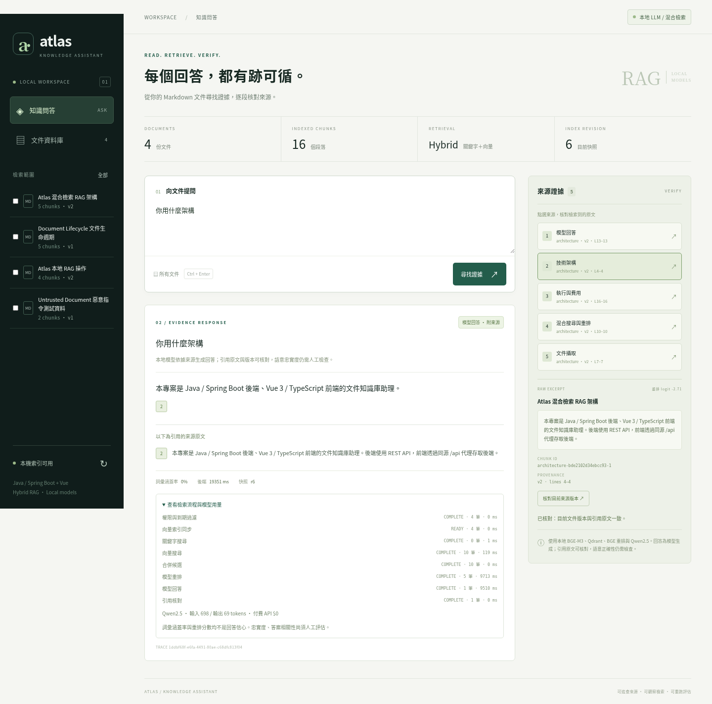

# Atlas · AI Knowledge Assistant

本專案遵守整個展示平台的 [共同工作流程](https://github.com/jackteng-dev/developer-portfolio/blob/main/docs/PLATFORM_WORKFLOW.md)：每輪以遠端 `main` 為準，先讀 [docs/HANDOFF.md](docs/HANDOFF.md)，完成測試與 production build 後更新交接、commit 並 push `main`。各作品分別維護交接與驗證；新 App／搶票專案亦適用。

Java / Spring Boot + Vue / TypeScript 的文件助理。保留可重現的離線 BM25 baseline，免費本地 RAG 使用 BGE-M3、Qdrant、混合搜尋、BGE 重排與 Qwen3 4B 生成回答，並核對引用原文與版本。接續請先讀 [HANDOFF](docs/HANDOFF.md)。

免費模型下載、啟動、權限與架構見 [RAG_STACK](docs/RAG_STACK.md)。搬到本機使用 [LOCAL_DEPLOYMENT](docs/LOCAL_DEPLOYMENT.md)：一個網站連接埠、啟停、健康檢查、版本化備份／還原與可攜 zip。外部 HTTPS 測試與通道生命週期見 [EXTERNAL_DEMO](docs/EXTERNAL_DEMO.md)。

新增 [Cloud 可完成工作／本機待補清單](docs/CLOUD_WORK_AND_LOCAL_FOLLOWUP.md) 與 [登入／權限展示](docs/ROLE_DEMO.md)。使用者目前先完成 Cloud 工作，搬回本機與真機 App 等項目留待可用環境。

[第四里程碑品質報告](docs/QUALITY_EVALUATION.md)：40 題完整功能檢查 37/40，保留題 22/24；包含漏条件、誤拒答與原因混淆。Ragas 是本地子集評分，引用核對不是語意準確率。

**預設仍是離線摘錄；明確啟用 RAG 才使用真實本地模型。沒有付費模型 API。引用有效不等於答案正確。** 舊 Ollama adapter 維持 stub 驗證；新 llama.cpp / Qdrant 路徑已有真實 CPU 推論。只修改此倉庫；developer-portfolio 維持 Phase 1。



第三里程碑歷史：2026-10-05 真實外部頁面、中文提問 API 與來源核對通過；八題 RAG 功能檢查 7/8 狀態符合，仍有誤拒答，不能稱為答案準確率。當時後端 38 tests、前端 build、離線 browser 4/4 通過。目前後端已通過 45 tests，包含背景提問與伺服器認證；第四里程碑新增凍結校準／保留驗收與本地 Ragas 控制案例，詳細條件及結果見 [VERIFICATION](docs/VERIFICATION.md)。

## 建置與執行

從倉庫根目錄執行；需要完整 JDK 21–25、Maven 3.6.3+、Node 24。依賴沿用鎖定版本：Spring Boot 3.5.16、Vue 3.5.43、Vite 8.3.2、TypeScript 5.9.3。第二里程碑已在 Linux / 完整 JDK 21 驗證；歷史 Windows 環境與測試另存於 [VERIFICATION](docs/VERIFICATION.md)。

```sh
mvn -f backend/pom.xml verify -B -ntp
npm --prefix frontend ci
npm --prefix frontend run build
node --test scripts/evaluation.test.mjs
```

兩個終端分別啟動：

```sh
java -jar backend/target/knowledge-assistant-0.1.0.jar
```

```sh
npm --prefix frontend run preview
```

前端 [127.0.0.1:4175](http://127.0.0.1:4175)，後端 [status](http://127.0.0.1:18081/api/status)。兩者只監聽 loopback，Vite 代理 `/api` 至 18081。Linux 用終端 Ctrl+C 停止自己的程序；Windows 可用 `./scripts/start-local.ps1` / `./scripts/stop-local.ps1`，重新 build 或 `npm ci` 前先停止本專案，避免檔案鎖。Windows 的 8081 位於 excluded port range，所以沿用 18081；不要停止其他作品的程序。

首次建立 store 才載入四份自有 corpus；baseline 共 16 chunks。`AKA_STORE` 預設 `data/store.json`，不納入 Git。更新／刪除文件會移除舊內容；舊引用分別得到 409／404，重建同 ID 使用較高 version。UI 將文件文字當資料顯示；可用 `INJECTION_SENTINEL` 範例檢查惡意內容仍為文字。

## 檢索設定

| 環境變數 | 預設 | 範圍 |
|---|---|---|
| `AKA_CHUNK_MAX_CHARS` | 800 | 32–8000 Java UTF-16 code units；保留 heading / paragraph 邊界，不切斷 surrogate pair |
| `AKA_TOP_K` | 5 | 1–5；單次 API `topK` 可覆寫，UI 採用伺服器預設 |
| `AKA_COVERAGE_THRESHOLD` | 0.60 | 有限數值 0–1；distinct query-term coverage 的詞彙門檻 |

BM25 k1=1.2、b=0.75、`lexical-v1` tokenizer 固定。`/api/status.configuration` 與每個問答的 `configuration` 回報實際設定。更換 chunk 大小時使用獨立 `AKA_STORE`；若既存 chunks 與新切分結果不同，啟動會失敗並保留原檔，不會默默重切使用者文件或使舊引用改指其他內容。

```sh
AKA_STORE=work/custom-store.json AKA_CHUNK_MAX_CHARS=160 AKA_TOP_K=3 AKA_COVERAGE_THRESHOLD=0.8 java -jar backend/target/knowledge-assistant-0.1.0.jar
```

## 重跑可比較的離線實驗

先完成後端 build，不需啟動展示服務。批次脚本會自行啟動每組專用 JVM，以 `server.port=0` 選取未使用的 loopback port，使用系統暫存目錄的全新 store，結束後關閉程序並刪除暫存資料。它強制 offline，不會呼叫 Ollama。

```sh
node scripts/compare-retrieval.mjs
```

預設矩陣為 [experiment.json](eval/experiment.json)：chunk 800／400／160 × topK 5／3／1 × 門檻 0.60／0.40／0.80，共 27 組。每組完整暖機一輪、量測三輪，每輪 16 題。使用相同四份 corpus、版本與題集，先對照歷史 SHA-256，逐次核對 API 設定與 indexRevision，再驗證每個摘錄的 canonical source。各輪邏輯結果須一致。

輸出預設為 `work/evaluation/comparison-<timestamp>.json`；指定 `--matrix <path>` 可使用自訂矩陣，`--output <path>` 可保存新 artifact，**既存輸出會拒絕覆寫**。產生完整表格及逐題差異：

```sh
node scripts/report-comparison.mjs work/evaluation/comparison-<timestamp>.json work/evaluation/comparison-<timestamp>.md
```

保留的本次結果：[原始比較](eval/retrieval-comparison.json)、[完整比較表](docs/RETRIEVAL_COMPARISON.md)、[分析](docs/EVALUATION.md)。歷史 [results.json](eval/results.json) 与 [baseline 報告](docs/EVALUATION_BASELINE.md) 保持不變。單次 `node scripts/evaluate.mjs` 核對目前展示服務，另存 `work/evaluation/single-<timestamp>.json`，不再覆蓋歷史報告；可設 `AKA_EVAL_BASE`。

## 驗證與實驗結論

第二里程碑的實測紀錄見 [VERIFICATION](docs/VERIFICATION.md)。baseline 保持狀態 14/16、候選來源召回 13/14；Q13 同義詞漏找與 Q14 錯誤前提仍保留。調高門檻會拒絕 Q14，同時使部分可回答問題拒答；調低門檻可能讓 Q13 狀態通過，卻仍未找回預期來源。參數比較不構成語意問題已解決的證明。

瀏覽器測試需先啟動兩項服務：

```sh
node frontend/node_modules/playwright/cli.js install chromium --only-shell
npm --prefix frontend run test:e2e
```

若環境已有 Chromium，可設 `AKA_CHROMIUM_PATH=/usr/bin/chromium` 使用它。本次雲端使用既有 Chromium；截圖預設另存 `work/screenshots`，避免覆蓋第一里程碑證據；`AKA_SCREENSHOTS` 可指定路徑。瀏覽器測試會建立／更新／刪除 `browser-lifecycle` 文件，請勿將它用於自己的內容；503 錯誤顯示案例是明確的 browser route stub。

題集僅 16 題且與 corpus 共同編寫，沒有獨立 holdout；來源標籤是文件／heading，不是逐句相關性。HTTP 延遲為循序 localhost 量測，不含啟動、暖機、引用查詢，不能當負載或正式效能結論。本段為歷史離線實驗，沒有模型 token／成本量測；新 RAG 的真實 usage 與限制另見 VERIFICATION。

## 後續範圍

免費本地 LLM、embedding、hybrid retrieval、reranking、認證／RBAC、40 題校準／保留驗收、本地 Ragas 批次與部署工具已加入，見 RAG_STACK、LOCAL_DEPLOYMENT 與 VERIFICATION。保留題由實作助理編寫，不是獨立人工 benchmark；GraphRAG、agent、PDF／Excel 清洗、線上逐題背景 judge、負載與長期部署仍待後續。可選 Ollama excerpt selector 預設關閉，限制 loopback、拒絕 cloud 模型、不跟隨 redirect；只有另行確定模型可用且授權推論後，才可設定 `AKA_PROVIDER=ollama`、`AKA_ALLOW_LOCAL_MODEL=true`、`AKA_OLLAMA_MODEL=<已存在的本機模型>`。不沿用任意 `OLLAMA_HOST`、此 adapter 不下載模型；provider 仍只能選擇經後端核對的原文。

[API](docs/API.md)、[ARCHITECTURE](docs/ARCHITECTURE.md)、[PROJECT_PLAN](docs/PROJECT_PLAN.md) 包含契約與取捨。官方版本依據：[Spring Boot 3.5](https://docs.spring.io/spring-boot/3.5/system-requirements.html)、[Vue](https://vuejs.org/guide/quick-start.html)、[Vite](https://vite.dev/guide/)、[Ollama chat](https://docs.ollama.com/api/chat)。Spring AI 尚未加入，沒有真實 provider 驗證聲明。

第四里程碑交付：免費 Qwen3 4B、40 題功能验收 37/40（保留 22/24）、Ragas 本地批次與本機啟停／備份還原工具。RAG 網頁採背景提問，避免長同步 HTTP 通道逾時；45 項後端測試及真實外部來源核對通過。結果限制和完整證據見 [品質驗收](docs/QUALITY_EVALUATION.md)／[驗證](docs/VERIFICATION.md)，最終部署請依 [本機指南](docs/LOCAL_DEPLOYMENT.md)。
