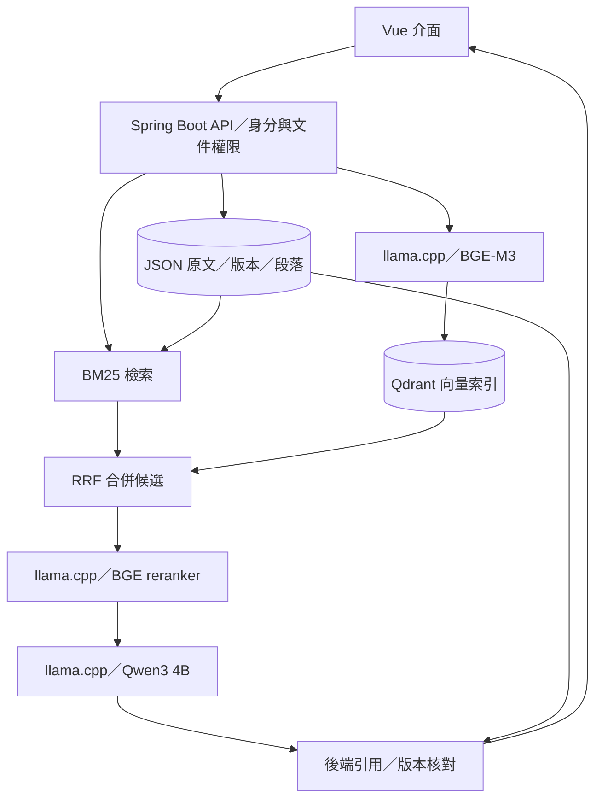

# Atlas

*A fully local RAG knowledge assistant with version-verified source citations.*

Atlas 是以 Java／Spring Boot 與 Vue 建置的本地文件知識助理，適合需要查詢內部規範或技術文件、並核對回答依據的使用者。
匯入 Markdown 後，可用自然語言提問、查看引用原文與文件版本；模型、向量資料庫及原始文件皆在本地執行與保存，無須付費模型 API。

## 展示

目前僅於作者自架伺服器私人執行，因 CPU 推論資源需求，**不提供公開 Demo 或公開唯讀版**。
可從[原始碼](https://github.com/jackteng-dev/atlas-rag)、[角色權限展示紀錄](docs/ROLE_DEMO.md)與[品質報告](docs/QUALITY_EVALUATION.md)審閱實作；文件中的歷史外部測試不代表目前有可用的公開服務。

## 主要功能

- Markdown 匯入、更新與刪除，保存文件版本、內容雜湊、穩定段落 ID 與原文行號。
- 本地 RAG：BGE-M3 向量檢索與 BM25 經 RRF 合併，再由 BGE reranker 重排、Qwen3 4B 生成附引用的回答。
- 來源面板核對引用原文與當前版本；證據不足時明確拒答，文件改版或刪除後拒絕舊引用。
- 登入與角色／部門權限，於檢索、模型上下文及來源端點排除未授權或已過期文件。
- 背景提問與結果輪詢、處理狀態與錯誤顯示；切換帳號後清除工作區並丟棄舊身分回應。
- 保留無模型的 BM25 原文摘錄模式、固定評估題集、檢索參數比較及本地 Ragas 批次報告。

## 技術架構

| 層 | 技術 |
|---|---|
| 前端 | Vue 3、TypeScript、Vite；`local-web` 模式將靜態資產打包進 Java JAR |
| 後端 | Java 21+、Spring Boot 3.5、Spring MVC、Spring Security |
| 原文與版本 | 本地 JSON、不可變快照、檔案鎖與原子替換 |
| 檢索與重排 | BM25、BGE-M3、Qdrant、RRF、BGE-reranker-v2-m3 |
| 本地生成 | llama.cpp CPU、Qwen3-4B-Instruct-2507 GGUF Q4_K_M |
| 驗證 | JUnit、Playwright、Node 測試、Ragas 離線評分 |

以下為啟用 RAG 時的流程；預設離線模式僅使用 BM25 與原文摘錄，不呼叫模型。



模型與執行檔由下載腳本依固定版本及 SHA-256 核對，不存入 Git；詳細流程見[本地 RAG 架構](docs/RAG_STACK.md)。

## 工程重點

- **來源一致性**：後端只接受實際檢索到的段落與引用原文；來源 URL 綁定文件版本，改版回傳 409、刪除回傳 404，避免舊引用指向新內容。見[版本與引用設計](docs/ARCHITECTURE.md)。
- **並行寫入與持久化**：更新／刪除要求預期版本，以檔案鎖避免多程序共寫；先完成暫存檔寫入與原子替換，再發布新快照，失敗時保留舊狀態。見[儲存設計](docs/ARCHITECTURE.md)。
- **權限與不可信文件**：角色取自伺服器驗證身分，BM25 與向量查詢均限制授權文件及版本；文件中的指令與 HTML 作為資料顯示。見[權限規則](docs/RAG_STACK.md)與[角色驗證](docs/ROLE_DEMO.md)。
- **長時間 CPU 推論**：以 HTTP 202 背景工作與短請求輪詢交付結果，發布前重驗版本、權限與到期日；帳號切換時丟棄舊回應。見[API 契約](docs/API.md)。
- **可還原的原始資料**：備份保存同一 revision 的原文、段落與設定，還原前檢查路徑白名單、SHA-256 與 store lock；向量可依原文版本重新同步。見[備份／還原流程](docs/LOCAL_DEPLOYMENT.md)。

## 品質與交付

- [驗證文件](docs/VERIFICATION.md)記錄後端 45 項測試、前端型別檢查／production build，以及離線 Playwright 4/4 通過；部分模型契約與錯誤案例使用 stub，不能視為真實推論驗證。
- [品質報告](docs/QUALITY_EVALUATION.md)記錄真實本地模型的 40 題功能檢查 37/40、其中保留題 22/24；這是凍結候選的歷史結果，不是語意準確率或目前版本的重新量測。
- GitHub Actions 的 [`verify`](.github/workflows/showcase-verify.yml) 執行前端型別檢查／建置、Maven verify 與離線評估腳本測試，不執行新的真實模型品質評估。
- 交付流程為 PR → `verify` CI → 合併 `main` → [私人 GHCR 映像發布](.github/workflows/homelab-release.yml) → 作者自架伺服器以拉取方式執行 CD。[交付紀錄](docs/HANDOFF.md)保留部署與驗收狀態。

以上測試與評估數字均引自既有文件；本次僅改寫說明文件，未重跑測試、建置或部署。

## 本機啟動

Linux x64 或 Windows WSL2；原始碼建置需完整 JDK 21+、Maven、Node 24，模型工具另需 Python 3.10+、curl、tar。
在倉庫根目錄執行下列指令；模型下載約 3.82 GB，另需預留向量與備份空間，連接埠須未被占用。

```sh
npm --prefix frontend ci
npm --prefix frontend run build
mvn -f backend/pom.xml -Plocal-web verify -B -ntp
node scripts/setup-local-rag.mjs --download
cp config/local-deployment.example.json config/local-deployment.json
python3 scripts/local-deploy.py start --config config/local-deployment.json
python3 scripts/local-deploy.py status --config config/local-deployment.json
```

本機網站與 API 共用 `http://127.0.0.1:18081`；上述管理器啟用本地 RAG，直接啟動未設定的 JAR 則使用離線摘錄。
帳號設定、停止、備份／還原及故障排除見[完整本機指南](docs/LOCAL_DEPLOYMENT.md)。

## 已知限制

- 定位為小型、單實例文件助理；JSON 全量快照及按需索引不適合大型資料集，尚無負載與長期可用性保證。
- CPU 推論採單工作處理，忙碌時拒絕額外請求；冷查詢可能逾時。關閉頁面不會取消已接受工作，重啟服務會清除工作結果。
- 小模型仍會漏條件、誤拒答或混淆原因；引用核對只能證明來源有效，不能保證語意正確。評估尚未取得獨立人工語意標註，生成模型兼任 Ragas judge 亦有共同偏差。
- 目前支援 Markdown，未完成 PDF／Excel 清洗；帳號檔變更需重啟，沒有 SSO 或動態帳號管理。原生 Windows 的新模型執行流程未驗證。
- 未設定認證時，匿名使用者可操作公開文件的寫入 API；對外使用前須配置帳號與 HTTPS。

## 文件

- [架構與一致性設計](docs/ARCHITECTURE.md)／[本地模型與混合檢索](docs/RAG_STACK.md)
- [API 契約](docs/API.md)／[登入與權限展示](docs/ROLE_DEMO.md)
- [品質驗收與失敗案例](docs/QUALITY_EVALUATION.md)／[測試與驗證紀錄](docs/VERIFICATION.md)
- [離線評估方法](docs/EVALUATION.md)／[檢索參數比較](docs/RETRIEVAL_COMPARISON.md)
- [本機部署與還原](docs/LOCAL_DEPLOYMENT.md)／[開發紀錄（原 README）](docs/DEV_LOG.md)
