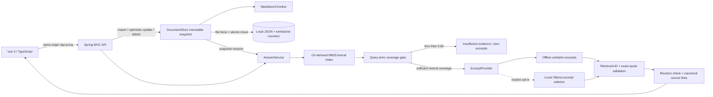

# Architecture — offline baseline and local RAG

第三里程碑的免費本地 RAG、語意段落合併、Qdrant、混合搜尋／重排、模型回答、metadata／RBAC 與操作限制見 [RAG_STACK](RAG_STACK.md)。以下流程與 gate 說明保留為預設 offline baseline；新 RAG 不使用 60% 詞彙門檻。兩條路徑共用 JSON 原文／版本、canonical source、權限與到期檢查。

## Runtime flow

## Boundaries and decisions

`ApiController` provides REST and validation. `DocumentStore` owns mutations, file locking, version counters and immutable snapshots. `MarkdownChunker` owns deterministic IDs and line provenance. `KeywordRetriever` is a pure BM25 retrieval component. `AnswerService` gates evidence, validates provider selections and maps citations. `ExcerptProvider` isolates optional inference from ingestion and retrieval. Vue has a typed API client and explicit loading/error/empty states.

No vector store or database server is needed for this small demonstration. Per-query term-frequency/document-frequency structures are built from the current immutable document snapshot. This is a **real lexical index built on demand**, not an externally persisted inverted index, embedding index or semantic RAG. This avoids stale cache behavior and favors easy lifecycle review over throughput; query time grows with corpus size.

Corpus loaded from packaged classpath resources on a fresh store. Imported Markdown is stored in `data/store.json` by default, never written to the sample resources. `AKA_STORE` selects another local file. Metadata includes document ID/title/version, raw Markdown SHA-256, update timestamp and current chunks. No historical Markdown revision archive is retained.

## Chunk identity and source provenance

Split at headings and blank lines; blank lines and heading-like text inside backtick/tilde fences remain data. Default maximum chunk body length is 800 Java UTF-16 code units (configurable 32–8000); splitting avoids breaking surrogate pairs. Oversized paragraphs and lines split without overlap. Heading text is metadata, not evidence term matching. Heading-only Markdown returns 400.

ID = `documentId + '-' + first16(SHA256(documentId + '\n' + heading + '\n' + body)) + '-' + occurrence`.

Unchanged content under the same heading in the same document preserves its ID even when earlier paragraphs are inserted. Duplicate identical blocks are distinguished by occurrence order. Reordering duplicates can change which occurrence an ID denotes; a heading change or paragraph boundary change creates a new ID. This is deterministic content addressing, not a universal semantic identity guarantee. The 64-bit hash prefix is adequate for a small demo and has a theoretical collision risk; scaling should use the full digest.

Every source carries document ID, **version**, heading, original line range and excerpt. Lookup uses `/api/documents/{id}/chunks/{chunkId}?version=n`. Version is required even when a chunk ID is stable. Updated versions return 409 for older citations; deleted documents return 404. Recreating a deleted ID increments its retained counter, so an old citation cannot resolve to a newly created document by accident.

## Mutation and concurrency

Create/update/delete serialize in `DocumentStore`. Update and delete require expectedVersion; stale clients receive 409. Exact no-op updates preserve version/revision. A mutation writes the complete next store into a sibling temp file, forces file contents, then uses atomic replacement; only after success is the volatile snapshot switched. Failed persistence keeps the old active snapshot. NTFS atomic replacement was exercised; unsupported filesystems fail instead of silently weakening atomicity. Directory fsync and crash/power-loss fault injection were not validated.

A sibling file lock prevents simultaneous writers to the same store. Corrupt or unsupported stores fail startup without overwriting content. There are no multi-process readers, distributed locks or automatic migrations. Version tombstones remain after deletion. API queries use one snapshot and include its indexRevision. If it changes during selection, the API returns INDEX_CHANGED instead of an answer. Another mutation can happen after a response; the source lookup then detects a stale citation and the UI prompts re-query.

## Retrieval and evidence gate

Tokenization: lowercase ASCII letter/number sequences; English stop words removed; explicit trailing-s plural normalization (excluding `ss`/`us`, plus `ids` → `id`); Chinese Han sequences become overlapping character bigrams, single characters retained. This intentionally simple rule is not general stemming, multilingual morphology or synonym matching. No fuzzy expansion is applied.

BM25 uses k1=1.2, b=0.75; IDF = `ln(1 + (N-df+0.5)/(df+0.5))`. All chunks in the selected document scope define N and average length. Score only body text; discard zero-score chunks, sort score descending, chunk ID ascending for ties, return topK (configured default 5, maximum 5). DocumentIds absent or empty means all current documents. Unknown selected IDs fail 404.

Coverage = distinct matched query terms across returned hits / distinct non-stop query terms. Fewer than the configured threshold (default 60%) or no hits gives INSUFFICIENT_EVIDENCE with zero answer excerpts; matching candidates may still be shown. Coverage is a **lexical heuristic**, not semantic evidence sufficiency. Q13/Q14 expose synonym misses and false-premise acceptance. Milestone 2 measures gate tradeoffs in the fixed set; no semantic accuracy gain is claimed.

## Provider and untrusted documents

Offline provider returns verbatim excerpts, no synthetic answer. Optional Ollama selector uses a system instruction and JSON serialized question/evidence, stream=false, JSON output, temperature=0, prediction bound, 2-second connect/10-second request timeout and no redirect. Explicit opt-in and a model name are required; loopback origins only, cloud-named models refused. It does not download models or automatically consume existing remote credentials.

Provider output can contain at most five `{chunkId, quote}` segments. Unknown IDs, blank quotes and non-substring quotes return 502. The backend creates source URLs from its own retrieved document/chunk metadata. Exact-quote validation proves provenance, not relevance or entailment. A model could still select misleading or malicious text as a quote; it cannot make it an application instruction through this path. Real Ollama behavior remains unverified; the separate llama.cpp RAG path has actual embedding/reranker/generation checks recorded in VERIFICATION.

Vue uses escaped text interpolation, blockquote/pre text and buttons, never raw Markdown HTML or document-generated links. The malicious fixture deliberately includes fake ID, hostile URL and script markup, all shown as inert source data. API is same-origin through Vite and bound to loopback. Default public demo permits public-policy documents only; AKA_AUTH_USERS_FILE enables bcrypt Basic authentication and server-owned roles/departments for protected documents. See RAG_STACK. The temporary HTTPS tunnel is a test demo.

## Operational limits

The `local-web` Maven profile packages Vue assets into the Java jar. Authenticated deployments allow public HTML/assets and status so the login page loads, while `/api/**` data remains authenticated. `local-deploy.py` manages owned processes on Linux/WSL2, checks all model/web/API endpoints, and snapshots source data with checksums and a Java-compatible restore lock. See LOCAL_DEPLOYMENT. Current generation is Qwen3 4B; the historical Ollama and Qwen2.5 results remain distinct.

Generation uses an exclusive JSON schema branch: refusal has `answerable=false` and an empty statements array; an answer has `answerable=true` and one to three cited statements. The backend still validates both consistency and citation IDs rather than trusting grammar alone. Rerank selection requires both the absolute raw-logit floor (-8) and distance from the best candidate (<=5); these are heuristics calibrated on sixteen questions, not probabilities. The twenty-four frozen holdout questions are not used to tune this release.

Local Ragas batch evaluation is separate from live question handling. A constrained loopback-only judge and BGE embeddings use modern Ragas scoring components, first checked against known correct/incorrect/off-topic controls. Failed judgments remain null with coverage; generated answers, reference labels and source excerpts can be reviewed in a worksheet. Generator/judge correlation and synthetic assistant-authored labels prevent claims of independent semantic accuracy.

Individual Markdown limit: 200,000 Java characters; title 120; query 1,000; topK 1–5; document ID lowercase ASCII slug up to 64. Frontend API timeout: 150 seconds for questions, 30 seconds for other calls. Corpus-wide storage limits, HTTP body streaming limits, rate limiting, pagination, parallel throughput/load and long-running retrieval cancellation are not implemented. Current corpus size is deliberately small. JSON whole-snapshot writes and on-demand indexing should be replaced or bounded before large-scale use.

## Reproducible parameter experiments (milestone 2)

`RetrievalConfiguration` validates startup settings and exposes effective metadata in status and each answer. UI queries omit topK so the server default is used. Persisted chunks are verified against deterministic chunking before publishing a snapshot; mismatches fail without rewriting the store.

`compare-retrieval.mjs` starts one fresh offline JVM/store per matrix setting, discovers its OS-assigned loopback port, verifies historical corpus/dataset hashes and versions, warms up the full set, then measures repeated fixed-order passes. Every answer must report the expected settings and same revision. Citation checks resolve canonical document/chunk/version paths. Only query HTTP calls are timed. Logical result stability is checked across repetitions; output records jar/matrix/dataset hashes, Java/Node/OS, settings, sources, selections, request IDs and timing samples. A new output path is reserved exclusively; previous artifacts are never overwritten. Processes and temporary stores are cleaned up, including handled SIGINT/SIGTERM cancellation.

The original baseline artifact stays immutable. Candidate recall and selected-excerpt recall are separated because gate refusal leaves retrieval candidates visible. Section-level labels and exact quote/provenance checks do not establish semantic entailment. The fixed corpus's descriptive 800/5/0.60 statements continue to describe the historical baseline; experiments do not rewrite corpus content to match settings.

Background question delivery uses an admitted single worker with captured server actor and bounded, ephemeral owner-scoped job results. Poll publication rechecks current store revision, source versions, permissions and natural expiry. The synchronous API and the actual retrieval/generation pipeline remain compatible; changing browser identity invalidates pending responses. See API background contract for timeouts and lifecycle.
