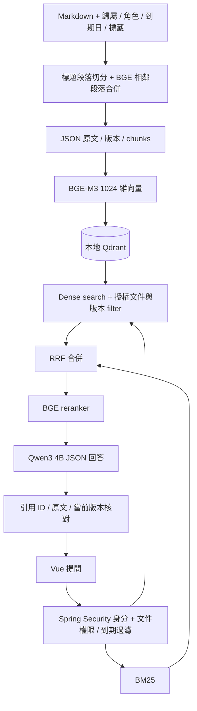

# 免費本地 RAG

2026-10-05（Asia/Taipei），接續 `codex/ai-retrieval-evaluation` / `d22eb15`。使用者已解除真實模型下載／推論限制，要求先採完全不需付費的方案。沒有付費 API、API key 或訂閱需求；既有運算環境、磁碟與網路仍是執行資源。本次只操作 ai-knowledge-assistant。

參考 [RAG 實作教學 2026](https://hanbz.dev/articles/rag-implementation-tutorial-2026/) 的攝取、metadata、權限過濾、混合檢索、重排、生成與評估架構。保留 Java / Spring Boot 與 Vue，不需要為此換成 Python 框架。這是可運行的小型實作，沒有宣稱涵蓋文章所有企業功能。

## 流程與免費元件



| 元件 | 固定版本 / 模型 | 授權 |
|---|---|---|
| 推論 runtime | llama.cpp b11401 CPU Linux x64 | MIT |
| 生成模型 | Qwen3-4B-Instruct-2507，GGUF Q4_K_M；歷史 Qwen2.5 1.5B 可選 | Apache-2.0 |
| embedding | BGE-M3，GGUF Q8_0，1024 維 | MIT |
| reranker | BGE-reranker-v2-m3，GGUF Q8_0 | Apache-2.0 |
| 向量資料庫 | Qdrant 1.19.1，專案獨立程序 | Apache-2.0 |
| 外部測試通道 | Tunnelmole 2.4.0 免費隨機 HTTPS | 暫時測試用途 |

下載版本、上游 commit、SHA-256、大小與授權見 [artifact manifest](../config/local-rag-artifacts.json)。目前五項下載合計約 3.82 GB（十進位）；`--legacy` 的歷史組合約 2.44 GB。完整工具、依賴、store 與模型位於 Git 忽略的 `work/`。主機顯示 3 CPU / 9.7 GiB，但容器實際 cgroup 限額為 2 CPU / 8 GiB；runtime 按限額配置執行緒。CPU 小模型仍會誤拒答、漏條件或答偏，引用有效不等於句子受來源支持。

目前建議使用 [本機部署套件](LOCAL_DEPLOYMENT.md)：frontend 打包進 Java，一個網站連接埠，提供啟停、健康檢查與原始資料備份／還原。下方手動兩服務方式仍可用於開發。Windows 使用 WSL2 Linux x64，沒有聲稱已測試原生 Windows 的新模型 runtime。

## 建置及啟動

需要完整 JDK 21–25、Maven、Node 24、Python 3、curl；目前下載腳本固定 Linux x64。其他 OS 請選相容的上游 runtime。沒有全域 DB 或 Docker 安裝。

```sh
mvn -f backend/pom.xml verify -B -ntp
npm --prefix frontend ci
npm --prefix frontend run build
node scripts/setup-local-rag.mjs --download
```

下載沿用環境的 HTTP(S)_PROXY 與 CA trust，SHA-256 不符不會安裝；不覆蓋已核對的執行檔。已下載時省略 `--download`，只核對。先啟動模型 runtime，等待三個 `/health` 與 Qdrant `/readyz` 都回傳 200，再啟動應用程式：

```sh
python3 scripts/local-model-runtime.py
```

```sh
python3 scripts/demo-supervisor.py --rag
```

兩個終端維持運行。模型 ports：LLM 18111、embedding 18112、reranker 18113、Qdrant 16333/16334；應用 18081、前端 4175，全部 loopback。啟動腳本拒絕占用的 ports，避免碰觸其他專案。模型 runtime 任一子程序退出會關閉自己的其餘子程序並留下日誌，修復後手動重啟。應用 supervisor 每兩秒重啟退出的應用／通道子程序，使用 jar 的不可變複本，重建不會破壞執行中的 lazy class loading。

新 RAG store 使用 `work/rag-demo-store.json`，避免用新切分設定重寫個人或歷史 baseline store。首次啟動仍載入原始 corpus；展示目前架構時，執行：

```sh
node scripts/bootstrap-rag-demo.mjs
node scripts/evaluate-rag.mjs
```

bootstrap 只接受原始 seed、已知歷史 RAG seed 或相同展示文字，拒絕覆蓋自訂文件；目前展示文件位於 `rag-corpus-v4`。歷史 `rag-corpus` 與八題 artifact 保持不變，40 題驗收也引用凍結的歷史架構文件，因此其中 Qwen2.5 是文件事實，不代表現在推論模型。baseline 資源與 `eval/results.json` 保持不變。

未設定 `AKA_RAG_ENABLED=true` 時預設仍是 BM25 原文摘錄，不呼叫這些模型。手動啟動 jar 要設定 `AKA_RAG_ENABLED=true AKA_CHUNK_STRATEGY=semantic AKA_STORE=<獨立 store>`；舊 `AKA_ALLOW_LOCAL_MODEL` 只控制 Ollama 摘錄 adapter，與新 RAG opt-in 分開。模型 client 僅接受 loopback origin，不會自動使用環境中其他 provider key。

## 權限與 metadata

文件 metadata：`department`、`owner`、`expiresAt`、`allowedRoles`、`tags`。舊 store 缺值會載入公開預設，metadata 改變也使版本增加。metadata 由匯入者／管理者設定；沒有自動猜測部門或權限的 LLM enrichment。過期文件可供有權限的人查看管理資訊，但在 BM25、dense search、模型上下文与 canonical source endpoint 之前排除。

預設公開展示只處理公開文件。要使用保護文件，設定 `AKA_AUTH_USERS_FILE` 指向 Git 忽略的 JSON 陣列，每筆含 `username`、`passwordHash`（bcrypt）、`roles`、`departments`。密碼由管理者在本地建立，不把明文、真實帳號或 hash 放入 Git。帳號檔於啟動載入，修改後需重啟。

角色來源是 Spring Security 的已驗證 principal；不接受自填角色 header 或 `documentIds` 作為權限。ADMIN 可管理文件；擁有者需 EDITOR 權限才能寫入；其他人讀保護文件需要允許角色與相符部門。Basic Authorization 僅在 UI 記憶體保留，重新整理需重登入；對外登入需 HTTPS。公開展示沒有設定真實保護帳號。

兩路搜尋都以授權／未過期文件 snapshot 為範圍；Qdrant query 加入文件 ID + 當前版本 filter，返回後再次核對。向量以版本化 ID upsert 成功後再清理舊點；JSON 原文是 canonical truth。引用由後端生成，文件指令與 HTML 以文字顯示。

## 可觀察性與品質限制

每題回傳 request ID、stage 耗時／候選數、生成 token usage、設定與引用；伺服器記錄這些 metadata，不記錄問題、原文或密碼。付費模型 API 呼叫為零。CPU 推論單題執行，同時提問回傳 `503 MODEL_BUSY`；模型 HTTP 120 秒、UI 問答 150 秒逾時。

RRF k=60；兩路各取 10 個候選，模型重排後最多保留 5 個。目前門檻是 **raw logit -8.0** 且距最佳候選至多 5.0，可由 `AKA_RERANK_MIN_SCORE` / `AKA_RERANK_MAX_GAP` 配置；這不是機率或信心。歷史第三里程碑門檻為 -6.0，沒有相對窗口。semantic chunking 是同 heading 相鄰段落的 embedding cosine 合併（≥0.72 且不超過 chunk 上限），保留原文與行位置，沒有跨 heading 的全文件語意分析。

目前評估包含狀態／必要詞組、heading 來源標籤、canonical source／引用、token 與循序延遲；40 題分為校準 16 與保留 24，由實作助理編写，不是獨立人工 benchmark。Ragas 0.4.3 另以本地 Qwen3 與 BGE-M3 批次評分 context precision、faithfulness、answer relevance，先檢查五個已知對錯控制案例（含兩段資料共同回答）。問答 API 的 `evaluation` 仍標示當次語意未量測，批次報告不增加線上延遲。生成模型兼任 judge 有共同偏差，短中文 prompts / strictness=1 也不同於預設配置，須對照原文人工核查。TruLens、GraphRAG、多步 agent、PDF／Excel 清洗、全域觀測平台、負載與長期部署未完成；實際分數、覆蓋率與錯誤見 VERIFICATION。

## 本地 Ragas 批次

```sh
python3 -m venv work/venv-ragas
work/venv-ragas/bin/pip install -r config/evaluation/requirements-lock.txt
work/venv-ragas/bin/python scripts/evaluate-ragas.py --controls
work/venv-ragas/bin/python scripts/prepare-acceptance.py --instance my-check --port 18086 --min-score -8
node scripts/evaluate-acceptance.mjs work/acceptance/my-check/instance.json calibration
# 最終候選固定後再跑 holdout；不能依其結果調參又把它當未見過的題目。
node scripts/evaluate-acceptance.mjs work/acceptance/my-check/instance.json holdout
work/venv-ragas/bin/python scripts/evaluate-ragas.py work/evaluation/實際驗收結果.json
```

需要先啟動模型 runtime；QA 帳密只在忽略的 work 產生，不會印出或匯出。Ragas 沒有付費 provider/key fallback，停用 telemetry，模型 origin 只接受 loopback 且禁止 redirect。分數無法取得時保持 null 並列明原因／覆蓋率；拒答與權限案例不能被填成完美的語意分數。cache 按模型 artifact 身分／prompt／schema 保存，報告分開記錄實際 request/token 與 cache hits。開源套件仍會安裝其 SDK 相依套件，這不代表呼叫了該供應商。

外部通道設定、程序持續運行方式與實測見 [EXTERNAL_DEMO](EXTERNAL_DEMO.md)。免費隨機通道依賴環境及程序，重連網址可能改變；固定域名／長期主機尚未配置。
