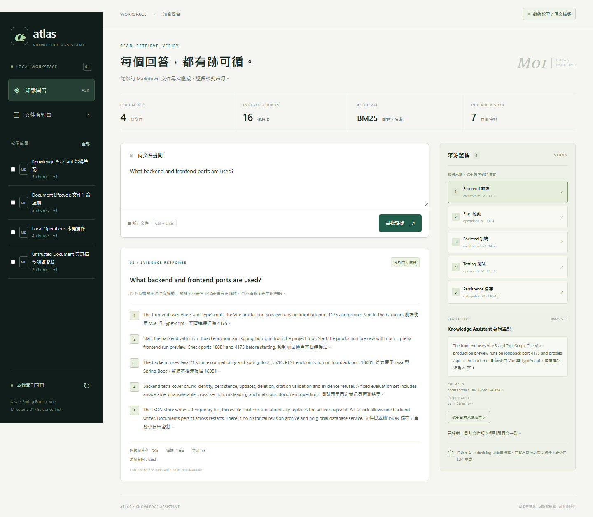
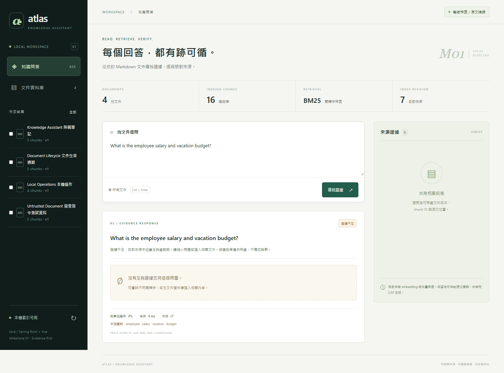

# Verification

## 2026-10-06：context 安全規則驗證

- 本輪前端型別檢查與 production build 成功（npm --prefix frontend run build）。
- 本輪後端 45 項通過，0 failure／error／skipped，build 成功。Maven verify；隔離 store／合約 stub，未執行真實模型推論。

八項規則完整且各倉庫／平台文件一致；條件與日誌雜湊見 [本輪摘要](verification/context-safety-2026-10-06.json)。本輪只改文件，未重跑瀏覽器／外部 HTTPS／真實模型品質。

## 2026-10-06：平台流程同步驗證

- **本輪實測**：前端型別檢查與 production build（`npm --prefix frontend run build`）成功。
- **本輪實測**：後端 45 項，0 failure／error／skipped，build 成功。Maven verify；合約與整合測試使用 stub／隔離暫存 store，未重新執行真實模型推論。
- **本輪實測**：評估腳本 3 項、部署／還原安全 5 項、Ragas 網路與判斷防護 3 項，共 11 項通過；使用 deterministic stubs，不算語意品質量測。

完整條件與非敏感日誌雜湊見 [本輪摘要](verification/platform-workflow-2026-10-06.json)。此輪沒有重跑瀏覽器、外部 HTTPS、真實模型品質或效能量測；下方原紀錄保持歷史日期與條件。

## 第五里程碑：Cloud 登入展示與本機待補交接

使用者要求先完成 Cloud 可做部分。本輪只修改 ai-knowledge-assistant，新增登入角色／部門呈現、唯讀文件操作與切換身分清理，並建立隔離的虛構人資文件展示。發呆亭收斂營運權限、ELPSY Shop 正式電商／App 與新搶票網站的方向及尚需本機／設備的事項見 [交接清單](CLOUD_WORK_AND_LOCAL_FOLLOWUP.md)，其他倉庫未更動。

| 驗證 | 結果 | 證據 |
|---|---|---|
| 後端 | 45/45；含角色來自已驗證 principal、偽造 header 不改變角色／部門 | [log](verification/milestone5-backend-verify.log) |
| 前端 | 型別檢查、production build、jar assets 與 dist 相同 | [log](verification/milestone5-frontend-build.log) |
| 離線瀏覽器 | 4/4，保持 baseline 匯入／更新／刪除、原文與來源、手機／錯誤處理 | [log](verification/milestone5-offline-browser.log) |
| 真實外部角色展示 | 匿名 401、一般／不同部門 HR 私有文件及來源 404、HR 唯讀／管理員可管理；API 與 browser 真實生成和來源按鈕通過 | [JSON](verification/milestone5-role-demo.json) |
| 一般帳號全庫查詢 | 真實檢索閘門拒答、無私有人資文件／金額；生成跳過 | [JSON](verification/milestone5-unscoped-privacy.json) |
| 示範準備防覆寫 | 重複 prepare／非初始 seed bootstrap 均拒絕，資料不變，帳號設定 0600 | [JSON](verification/milestone5-preparation-guards.json) |
| 身分切換中的舊回應 | 真實 HTTP 工作認證與所有權通過；延遲私有 browser 回應明確用 stubs，登入變更後丟棄 | [JSON](verification/milestone5-job-auth.json) |

流程與重現命令見 [ROLE_DEMO](ROLE_DEMO.md)。全部示範帳密只在忽略的私有 work 檔，不上傳；HR 文件是虛構數值。本次沒有重新調整或重跑既有 40 題 holdout，也没有在其他作品執行真實金流、App 真機或負載測試。第一輪外部測試的文件列表載入等待問題保留為 [log](verification/milestone5-role-demo-verification.log)，修正測試等待後 [通過](verification/milestone5-role-demo-verification-retry.log)。

## 第四里程碑：品質驗收與本機交付（2026-10-05，Asia/Taipei）

完整條件、原始結果與失敗分析見 [QUALITY_EVALUATION](QUALITY_EVALUATION.md)。免費 Qwen3 4B 真實推論，40 題凍結校準／保留驗收，local-web jar 在一個 port 提供網頁與 API。沒有付費 API，沒有修改其他倉庫。驗證執行時尚未 commit／push；後续 Git 同步依使用者於 2026-10-05 的明確指示進行。

| 項目 | 已完成實測 | 證據 |
|---|---|---|
| 後端交付版本 | 45/45，含背景工作身分、所有權、到期／改版、容量及錯誤保護；model contract 部分為明確 stubs | [log](verification/milestone4-async-backend-verify.log) |
| 前端 | typecheck + production build；jar 的 assets 與 dist 相同 | [log](verification/milestone4-async-frontend-build.log) |
| 新版離線瀏覽器回歸 | 4/4，真實原文／來源、文件更新刪除、惡意文字與手機／錯誤處理；錯誤展示項為明確 stubs | [log](verification/milestone4-async-offline-browser.log) |
| 原有評估腳本 | 3/3 | [log](verification/milestone4-evaluation-script-tests.log) |
| 40 題真實模型驗收 | 狀態 39/40、完整功能 37/40、來源 39/39、生成引用 36/36；保留题 22/24 | [原始 JSON](../eval/quality-results.json) |
| Ragas 校準控制 | 原四個控制 + 跨段落 C05，共 5/5；on-topic relevance > off-topic | [JSON](../eval/ragas-controls-calibrated.json) |
| 真實 Ragas 最終批次 | 十筆完成，三項各 9/10 可評；CP 0.9815、faithfulness 0.9630、relevance 0.8072；保留誤拆條件與完整性限制 | [JSON](../eval/ragas-results.json) |
| 部署保護測試 | 5/5；hash、檔案鎖、覆寫保留／拒絕、PID 與路徑限制 | [log](verification/milestone4-deployment-safety-complete-tests.log) |
| Ragas guards | 3/3，origin／redirect／NLI 改寫與 usage 保留；這些是明確 stubs | [log](verification/milestone4-ragas-guard-tests.log) |
| 真實 packaged 認證網頁 | 匿名頁面可載入但資料 401；reader／HR／不同部門、登出與 390px 通過 | [log](verification/milestone4-auth-web.log) |
| 真實備份／還原 | 活躍 Java lock 拒絕還原；v2 → v1，回答、來源與向量版本一致，移除舊向量，借用模型存活 | [JSON](verification/milestone4-local-lifecycle.json) |
| 固定 artifact | 五項當前下載與兩個 executable checksum 核對 | [log](verification/milestone4-artifacts-verify.log) |
| 背景提問認證 | 真實匿名 POST 401、其他帳號 GET 404、工作失敗不發布回答；瀏覽器延遲私有回應丟棄使用明確 stubs | [JSON](verification/milestone4-async-job-auth-verification.json) |
| 新版認證網頁 | 匿名頁面、reader / HR / 不同部門與登出再次通過 | [log](verification/milestone4-async-auth-web-retry.log) |
| 外部 HTTPS | 頁面 200、提問 202、poll 200；API / browser 各 5/5 來源與 1/1 生成引用，來源按鈕與 390px 通過 | [JSON](verification/2026-10-05-public-rag-v4-demo.json) |
| 自行管理整套啟停 | 六個 listening ports 全關閉，網站／三個模型／Qdrant 退出，再經 checksum guard 重啟至全健康；獨立通道 supervisor 存活 | [JSON](verification/milestone4-owned-deployment-cycle.json) |

實際 cgroup 限額為 2 CPU / 8 GiB，主機顯示的 3 CPU／9.7 GiB 不是容器額度。最終功能失敗 D08／H06／H24 全部保留；不宣稱 37/40 是語意準確率。Ragas 是本地子集批次，使用同一 generator／judge，有相關偏差；獨立人工審核未完成。外部驗證於 2026-10-05 15:32（Asia/Taipei）完成；背景提問避免長同步 HTTP gateway 504，但自然權限改寫問句仍誤拒答。部署套件及交付 jar SHA 另記錄於 [本里程碑 manifest](verification/milestone4-manifest.json)，第三里程碑紀錄維持歷史條件。

## 第三里程碑：免費真實本地 RAG（2026-10-05，Asia/Taipei）

接續 `d22eb15`，使用者已解除模型限制並要求先不付費。只有此倉庫有變更，未 commit／push。沿用環境 proxy、CA 與網路政策；以 Linux 專案獨立 llama.cpp b11401 / Qdrant 1.19.1 啟動免費 Qwen2.5-1.5B Q4_K_M、BGE-M3 Q8_0、BGE-reranker-v2-m3 Q8_0。固定 SHA-256／下載來源見 [manifest](../config/local-rag-artifacts.json)，五項 checksum 均實際核對；沒有 paid API key 或付費模型呼叫。3 CPU / 約 9.7 GiB RAM，非 GPU／負載 benchmark。

| 實際檢查 | 結果 | 證據 |
|---|---|---|
| Maven verify / packaged jar | **38 tests，0 failures/errors/skips** | [backend](verification/milestone3-rag-backend-verify.log) |
| Vue typecheck / Vite production build | 通過；HTML 0.41、CSS 18.33、JS 87.59 kB | [frontend](verification/milestone3-rag-frontend-build.log) |
| 原有離線 browser regression | **4/4**；獨立 18083 / 4176 store，真實 packaged backend | [browser](verification/milestone3-rag-offline-browser.log) |
| 原有評估腳本 tests | **3/3** | [script tests](verification/milestone3-rag-evaluation-regression.log) |
| 原始 16 題離線 baseline | **14/16 狀態、13/14 heading 來源、49/49 引用**，不變 | [baseline run](verification/milestone3-rag-offline-evaluation.log) |
| 固定免費 artifact checksum | 五項均核對成功 | [checksums](verification/milestone3-rag-artifacts-verify.log) |
| 真實八題 RAG，第一輪 | **6/8 狀態**；另有 R04 重複問題的語意失敗 | [原始 artifact](../eval/rag-initial-results.json) |
| 提示修正後真實八題 RAG | **7/8 狀態、13 次 canonical source 核對、7/7 生成引用** | [最終 artifact](../eval/rag-results.json)、[run](verification/milestone3-rag-evaluation.log) |

新增 12 項後端測試：6 項混合檢索／RRF／更新刪除／權限過期與偽造候選／引用／semantic boundary；2 項實際 MVC 授權範圍／直接來源／客戶端角色偽造與到期拒絕；3 項 localhost HTTP 合約（embedding 順序／維度、JSON 回答引用／拒答、Qdrant filter 與先 upsert 後清理）；1 項真正 bcrypt Basic 認證／錯誤密碼／伺服器角色／不可寫入。模型 HTTP stub 合約不是實際推論；八題問答才使用真實免費模型。原有 26 項保留。離線 browser 的錯誤渲染仍含一個明確 route stub，其餘問答／生命週期／惡意 HTML／scope／手機版使用真實後端。

實際 Maven 命令（本環境工具位於忽略的 work，其他機器使用自己的完整 JDK／Maven）：

```sh
JAVA_HOME="$PWD/work/tools/jdk-21.0.12.1+1" \
MAVEN_OPTS='-Djavax.net.ssl.trustStore=/etc/ssl/certs/java/cacerts' \
work/tools/apache-maven-3.9.16/bin/mvn \
  -s work/tools/maven-settings.xml -Dmaven.repo.local="$PWD/work/tools/m2" \
  -f backend/pom.xml verify -B -ntp
npm --prefix frontend run build
node --test scripts/evaluation.test.mjs
AKA_BROWSER_BASE=http://127.0.0.1:4176 AKA_CHROMIUM_PATH=/usr/bin/chromium \
  npm --prefix frontend run test:e2e
node scripts/evaluate-rag.mjs
```

RAG 用獨立 `work/rag-demo-store.json`、`semantic` 切分，architecture / operations 展示文件為 v2，其餘兩份 v1，共 16 chunks。八題與新版 corpus 共同編寫，不是 holdout；未與歷史 16 題公平比較。無字面 BM25 命中的「你用什麼架構」由真實 dense retrieval 找回架構段落，再由 Qwen 回答 Java / Spring Boot / Vue 並引用正確原文。最終八題的生成 usage 為 **2211 input / 436 output tokens**；HTTP median **20766.5 ms**、p95 **51065 ms**。第一題包含 cold vector indexing；無排除暖機、不含 citation lookup，不能與先前 offline benchmark 的 latency 比較。

第一輪 R04 把問題複製成答案，R06 找到正確來源卻拒答。修正通用模型提示，將來源與自然語言問題分開、要求直接陳述答案；沒有針對題目寫固定答案，也未降低 gate。最終 R04 / R06 已回答並附來源。**R05 仍誤拒答**：相關權限段落 reranker logit 約 -7.52，低於 -6.0 門檻。保留失敗／原始紀錄。R07 薪資與 R08 錯誤前提均拒答。R03 回答流程但帶有不必要細節，不能僅憑狀態通過宣稱相關性完美。

7/8 是期望 status 符合數，**不是 87.5% 語意答案準確率**。Canonical 核對只驗證文件 ID、chunk ID、version、heading、line range、原文與 excerpt；生成引用還驗證 ID 存在於授權 context，沒有自動判斷逐句 entailment。`faithfulness` / `answerRelevance` 明確是 null／未量測；heading label precision 不等同 Ragas semantic context precision。沒有 Ragas / TruLens judge、GraphRAG、獨立 holdout 或負載／付費 API 實驗。

來源原文、historical corpus／questions／results／retrieval-comparison／screenshots 均未覆寫。新評估 artifact 使用獨立檔案，setup、evaluate 與 verification 保留 timestamp／拒絕覆寫輸出。持久化 JSON 是原文 truth，Qdrant 只保存 vector + metadata；實際端到端權限／生命周期主要由 deterministic backend tests 驗證，沒有宣稱真實模型能保證 RBAC 或抵禦所有 prompt injection。

外部 HTTPS 已於 2026-10-05 12:34（Asia/Taipei）通過真實頁面、問答、來源按鈕、無證據與手機版檢查；API / browser 各 5/5 來源、1/1 生成引用有效，零 pageerror / dialog / 手機溢出。見 [外部 JSON](verification/2026-10-05-public-rag-demo.json)、[log](verification/milestone3-rag-external-verification.log)、[EXTERNAL_DEMO](EXTERNAL_DEMO.md)。最新環境 revision 17 的 HTTP policy enforced / unrestricted；TCP 授權仍為空。下列第二／第一里程碑紀錄保留，描述當時 offline 條件。

## 歷史：第二里程碑

2026-10-05 UTC 另完成指定提交 `d22eb15` 的外部 HTTPS 離線展示驗證：後端 26/26、評估腳本 3/3、frontend typecheck/build、本機 Chromium 4/4 通過；外部真實瀏覽器提問與來源核對成功，完整外部題集的引用核對為 49/49。網路設定、實際命令、暫時通道與已解決的程序/proxy 問題見 [EXTERNAL_DEMO](EXTERNAL_DEMO.md)，外部實測 JSON 見 [紀錄](verification/2026-10-05-public-demo.json)。下列既有第二里程碑實驗證據保持不變。

驗證日期：**2026-10-05，Asia/Taipei**。工作目錄 `/workspace/ai-knowledge-assistant`。本段為第二里程碑的實際雲端驗證；下面保留第一里程碑的 Windows 紀錄，不能混用測試條件。

## Environment

Debian GNU/Linux 13 x64，kernel 6.18.44；Oracle 完整 JDK **21.0.12.1+1-LTS-4**，Maven **3.9.16**，Node **24.19.0**，npm **11.9.0**，Playwright **1.63.0** 搭配已安装的系統 Chromium **151.0.7922.173**。Java target release 21，本次已在完整 JDK 21 build／執行。依賴沿用原有 Spring Boot 3.5.16 與 npm lockfile，沒有改版本或加入 AI SDK。

雲端未提供 Maven；現有 Java 21 包含 compiler module，但缺少 JDK `ct.sym`／`javac`，初次 Maven 編譯回報 `release version 21 not supported`。Maven 的初次網路請求也未採用 session proxy 而失敗。修正方式：在忽略的 `work/tools/` 解壓 Maven Central 的 Maven binary 與 Oracle 完整 JDK，使用由繼承的 `HTTPS_PROXY` 產生的非機密 Maven proxy settings，並沿用 `/etc/ssl/certs/java/cacerts`，維持 TLS 驗證。沒有變更全域服務、DB、Docker、網路政策或其他倉庫。最終成功命令如下：

```sh
JAVA_HOME=/workspace/ai-knowledge-assistant/work/tools/jdk-21.0.12.1 MAVEN_OPTS="${MAVEN_OPTS:-} -Djavax.net.ssl.trustStore=/etc/ssl/certs/java/cacerts" work/tools/apache-maven-3.9.16/bin/mvn -s work/tools/settings.xml -f backend/pom.xml verify -B -ntp
npm --prefix frontend ci
npm --prefix frontend run build
node --test scripts/evaluation.test.mjs
PATH=/workspace/ai-knowledge-assistant/work/tools/jdk-21.0.12.1/bin:$PATH node scripts/compare-retrieval.mjs --output eval/retrieval-comparison.json
node scripts/report-comparison.mjs eval/retrieval-comparison.json docs/RETRIEVAL_COMPARISON.md
```

展示 backend 使用獨立 `AKA_STORE=/workspace/ai-knowledge-assistant/work/browser-store.json`／`AKA_PROVIDER=offline` 啟動 packaged jar（JDK 同上）於 18081；`npm --prefix frontend run preview` 於 4175。確認 port 未被使用後才啟動。批次實驗使用 OS 指派的其他 loopback ports；瀏覽器測試於批次完成後執行：

```sh
AKA_CHROMIUM_PATH=/usr/bin/chromium npm --prefix frontend run test:e2e
node scripts/evaluate.mjs
```

## Executed outcomes

| Command | 實測結果 | 證據 |
|---|---|---|
| Maven verify（完整 JDK／session proxy） | **26 tests、0 failures/errors/skips，packaged jar 成功** | [backend log](verification/milestone2-backend-verify.log) |
| npm ci | lockfile 安装成功（50 packages）；這次輸出未提供 audit 結果 | [ci log](verification/milestone2-frontend-ci.log) |
| frontend build | **vue-tsc 與 Vite production build 通過**；HTML 0.41 kB、CSS 16.68 kB、JS 81.76 kB（gzip前） | [build log](verification/milestone2-frontend-build.log) |
| Node evaluation tests | **3/3 passed** | [test log](verification/milestone2-evaluation-tests.log) |
| 27-setting comparison | **27 組各三輪邏輯結果一致**，1296 measured queries；1989/1989 measured citation checks | [run log](verification/milestone2-retrieval-comparison.log)、[raw artifact](../eval/retrieval-comparison.json) |
| Playwright / 系統 Chromium | **4/4 passed**，真實 packaged backend／production preview | [browser log](verification/milestone2-frontend-e2e.log) |
| 單次展示 API 評估 | **14/16、13/14、49/49**；另存 work，未覆蓋 baseline | [single log](verification/milestone2-single-evaluation.log) |
| 既有 artifact 覆寫拒絕 | **EEXIST 非零退出，SHA-256 不變**；歷史 results／questions 亦與 Git 基底逐 byte 相同 | [preservation log](verification/milestone2-output-preservation.log) |

保存的 Maven log 僅移除行尾空白，不改動測試結果。原有20項後端測試全部保留；新增6項 `RetrievalEvaluationTest`：固定題集歷史狀態／來源／引用數、嚴格門檻改善 Q14 同時拒絕 Q01、寬鬆門檻接受 Q13 卻仍漏 Update、topK=1 跨段落損失與覆寫 metadata、160-unit Unicode 切分／不相容 store 原檔保留、非法／非有限設定拒絕。Node 的3項測試使用明確 HTTP stub 檢查腳本：指標分離、median／p95、設定漂移／非離線／corpus version 不符拒絕、偽造 citation provenance 不計有效。

四項瀏覽器測試保留問答／引用核對／無證據、匯入更新刪除、惡意文字、scope／loading／error／390px layout；另外核對真實 status 與問答 configuration 一致。503 渲染依然是明確 route stub，其餘核心流量為真實後端。最新六張截圖在忽略的 `work/screenshots/`，[manifest](verification/milestone2-screenshots.json) 記錄實際 SHA-256／大小；桌面回答與手機畫面已目視檢查，歷史六張圖與其 manifest 保持不變。沒有重新宣稱第一里程碑截圖是本次畫面。

## Measured limits

baseline 800/5/.60 保持14/16；Q13/Q14失敗仍在。完整取捨見 [EVALUATION](EVALUATION.md)。400與800在本 corpus 切分相同，160才改變chunks；提高門檻改善拒答卻增加 false refusals。引用有效性不是答案準確率。

每組一輪全題暖機被排除，48個 query latency samples；測量為固定順序、循序 localhost，不含 citation lookup、啟動或暖機，不是負載測試，沒有獨立 holdout／語意 entailment 評分。批次開始時展示服務也啟動，可能影響早期主機狀態；瀏覽器在批次完成後跑。沒有真實 LLM、embedding、模型下載或付費呼叫。Mockito self-attachment 與 Playwright color warnings 未使測試失敗，無跳過項目。

## Historical milestone 1 record (preserved below)

下方「未 commit／push」、「Git 尚未初始化」與 Windows 工具版本等敘述，只描述當時紀錄；目前已是 GitHub 倉庫，第二里程碑依使用者要求提交到指定分支。

# Verification — milestone 1

驗證日期：**2026-10-04，Asia/Taipei**。實際程式碼、測試、產物與截圖都在 `D:\Project\ai-knowledge-assistant`。此文件只記錄已執行的結果。

## Environment and dependency selection

| Item | Observed |
|---|---|
| OS | Windows 11 amd64 |
| JDK | Eclipse Temurin OpenJDK 25.0.3+9 |
| Maven | 3.9.16，沿用本機安裝 |
| Node / npm | 24.16.0 / 11.13.0，沿用本機安裝 |
| Java target | release 21；未在 JDK 21 主機實跑 |
| Backend | Spring Boot 3.5.16，Tomcat 10.1.55 |
| Frontend | Vue 3.5.43，Vite 8.3.2，plugin-vue 6.0.9，TypeScript 5.9.3，vue-tsc 3.3.12 |
| Browser test | Playwright 1.63.0，Chrome Headless Shell 153.0.8010.12 / revision 1243 |
| Data | 4 project-owned Markdown documents，16 current chunks，sample document versions all 1 |
| Model / embedding | OFFLINE_EXTRACTIVE / NONE；no real model inference |
| Backend / preview | 127.0.0.1:18081 / 127.0.0.1:4175 |

Official compatibility checked against [Spring Boot requirements](https://docs.spring.io/spring-boot/3.5/system-requirements.html), [Vue quick start](https://vuejs.org/guide/quick-start.html), [Vite guide](https://vite.dev/guide/) and [Spring AI getting started](https://docs.spring.io/spring-ai/reference/getting-started.html). Maven Central metadata resolved Boot 3.5.16; npm registry metadata and peer/engine ranges resolved the selected frontend versions. Maven transitive versions are captured in [backend-dependencies.txt](backend-dependencies.txt); npm uses a committed-ready lockfile, no Git commit was created.

Spring AI 2.0.x was not added because its documented Boot 4.0.x/4.1.x support does not match this selected Boot 3.5 baseline. Optional Ollama native chat contract follows [official chat API](https://docs.ollama.com/api/chat). No AI SDK compatibility claim or real-provider verification is made.

Only credential **variable names/presence** were checked. No credential values printed or stored. No recognized OpenAI/Anthropic/Azure key name was present. Existing OLLAMA_HOST did not qualify as a verified loopback origin; it was not contacted or copied into project configuration. Model access and spending authorization were not established; **zero paid model calls**, zero real inference, zero embeddings, zero model downloads.

## Executed commands and outcomes

Commands ran with explicit shell workdir `D:\Project\ai-knowledge-assistant`.

| Command | Final result | Evidence |
|---|---|---|
| `mvn -f backend/pom.xml verify -B -ntp` | **20 tests，0 failures/errors/skips；executable jar packaged successfully** | [backend-verify.log](verification/backend-verify.log) |
| `npm --prefix frontend ci` | Installed 50 packages from lock；audit reported 0 vulnerabilities at this run | [frontend-ci.log](verification/frontend-ci.log) |
| `npm --prefix frontend run build` | **vue-tsc --noEmit + Vite production build passed** | [frontend-build.log](verification/frontend-build.log) |
| `npm --prefix frontend run test:e2e` | **4/4 passed** against real packaged backend and production preview | [frontend-e2e.log](verification/frontend-e2e.log) |
| `node scripts/evaluate.mjs` | 16 offline questions measured，status agreement 14/16 | [EVALUATION.md](EVALUATION.md)，[results.json](../eval/results.json) |
| `./scripts/start-local.ps1` | Real HTTP READY + preview 200；loopback listeners confirmed | [runtime.json](verification/runtime.json) |
| `./scripts/stop-local.ps1` + restart | Only this project's recorded processes stopped；persisted revision/document count matched after restart | same runtime checkpoint |

Final backend build ended at 23:29:57 local; latest retained evaluation was 23:32:01 local. Tests run sequentially against localhost, no load benchmark. Artifact sizes from production build: HTML 0.41 kB, CSS 16.68 kB, JS 81.72 kB before gzip. These are one observed build, not a performance guarantee.

20 backend tests consist of:

- MarkdownChunkerTest **5**: paragraph/heading split, stable IDs across preceding inserts, duplicate occurrence, line ranges, bounded fenced blocks, empty-document rejection, surrogate pair safety.
- DocumentStoreTest **5**: real JSON restart, old text removal, tombstones/recreation, no-op update, failed atomic replacement preserving active snapshot, simultaneous expectedVersion writers, writer lock, corrupt file preservation.
- AnswerServiceTest **5**: cross-section retrieval/exact quotes, insufficient/no evidence provider bypass, scope filtering, Chinese bigrams, malicious text as data, forged citation/quote refusal, changed-index refusal.
- ApiIntegrationTest **2**: Spring MVC JSON lifecycle and canonical citation 200/409/404, recreation version, payload/parameter/ID/topK validation and mode metadata.
- OllamaExcerptProviderTest **3**: localhost HTTP **stub** request/response structure and token fields, remote/cloud/missing-opt-in refusal, explicit HTTP 500 model-failure path. **No real model.**

Browser tests **4** cover actual questions, source current-version verification, no-answer state, import/update/delete in Vue, removed old query term, stale citation HTTP 409, deletion HTTP 404, malicious script/URL/fake-ID inert text, document scope, disabled loading button, error rendering and 390px mobile overflow check. The 503 error display uses a **simulated browser route response**; screenshots of normal functionality use the real backend. Browser console pageerror list and injection dialog count were empty in their checked flows.

## Fixed evaluation results

Corpus ID/version/hash and question-set SHA-256 are captured in [raw results](../eval/results.json). Configuration: chunk max 800 UTF-16 units, BM25 k1=1.2/b=0.75, topK=5, distinct query-term coverage threshold=0.60.

| Measure | Observed | Interpretation |
|---|---|---|
| Status agreement | **14/16** | Agrees with hand-authored expectations on this set |
| Reference recall at 5 | **13/14** | Expected labeled document/heading references retrieved |
| All references found | **11/12** answerable questions | Includes cross-section cases |
| Correct refusals | **3/4** unanswerable questions | Q14 remains a false positive |
| Citation validity | **49/49** | Exact quote plus current backend source version; not entailment |
| HTTP median / p95 | **2 / 59 ms** | Latest single sequential local run; first question includes warm-up |
| Model tokens/cost | **Not applicable** | No LLM request or embedding |

**Q13** uses synonyms (“obsolete passages … revisions”), misses the expected Update section and refuses despite the document having relevant information. **Q14** combines backend/frontend/port with unsupported salary terms: 60% lexical coverage passes the gate, so unrelated original excerpts appear. This is a documented evidence-gate failure, not a supported salary answer. Every response warns that excerpts do not confirm the question's premise. Citation correctness alone does not solve this limitation.

The dataset is small and authored with the corpus, not an independent holdout. There is no measured semantic accuracy, retrieval improvement, model comparison, token savings or parameter ablation. The initial evaluation and a final evaluation after the Unicode fix had the same logical results; the retained file contains only the latest run and its observed timings.

## Real screenshots

All images were produced by Playwright screenshots of the running Vue production preview using the real packaged backend. No generated/mock screenshot or altered image was used. SHA-256 and byte lengths are in [screenshots.json](verification/screenshots.json). Desktop capture viewport: 1440×1000, full page; mobile: 390×844, full page. Screenshots can be taller than viewport dimensions.

| File | Captured state |
|---|---|
| [01-workspace.png](screenshots/01-workspace.png) | Initial workspace, real counts, example queries and offline-mode label |
| [02-answer-sources.png](screenshots/02-answer-sources.png) | Cross-section port question, raw excerpts, chunk ID/version/line provenance and successful source verification |
| [03-insufficient-evidence.png](screenshots/03-insufficient-evidence.png) | Employee salary/vacation question, no excerpts and missing terms |
| [04-document-library.png](screenshots/04-document-library.png) | Real sample documents after browser fixture import/update/delete cleanup |
| [05-untrusted-document.png](screenshots/05-untrusted-document.png) | Malicious source displayed literally; real canonical chunk ID |
| [06-mobile.png](screenshots/06-mobile.png) | Responsive initial workspace at 390px |





Visual inspection confirmed desktop answer/source panel and mobile layout. All six images are final browser-test captures. Runtime checkpoint was taken after restart at revision 7. Browser lifecycle test then advanced the index to revision 10 while leaving four sample docs/16 chunks; sample versions/content did not change. Revision is not the number of documents and does not reset on fixture deletion.

## Issues encountered and resolved

1. Port 8081 appeared unused but actual bind failed. `netsh interface ipv4 show excludedportrange protocol=tcp` reported 8054–8153; direct TcpListener got AccessDenied. Port 18081 and 4175 bound successfully. Source, proxy, sample docs and scripts now use 18081. No Windows network exclusions were altered.
2. First stop script compared formatted date string with PowerShell's auto-parsed JSON DateTime, so it safely skipped a matching process. Changed comparison to UTC DateTime equality plus command-line path; final own-process stop/restart was exercised successfully.
3. Windows file locks prevented jar repackaging and `npm ci` while this project's jar/Vite preview were running. Stopped **only recorded owned processes**, reran Maven verify and locked npm clean install/build, restarted and repeated browser checks. README now instructs stopping the demo before rebuild. Final logs show successful outcomes.
4. A Maven dependency-tree command needed the `-DoutputFile` argument quoted for PowerShell parsing; the corrected command generated the retained manifest. A stray CSS import warning was removed before final build.

Mockito self-attachment/JDK agent warnings and Playwright color-environment warning are in logs; they did not fail tests. Future JDK restrictions may require explicit Mockito agent configuration. No silent test skips.

## Pending and practical limits

- Real LLM inference and embeddings **unverified**; optional provider only contract-tested. Model timeout code exists but has not been executed against a real/stalled model.
- Synonym retrieval, semantic sufficiency, hybrid retrieval, reranking and free-text generation pending.
- No historical revision archive, large-corpus pagination/body-streaming quotas, load validation or crash/power-loss fault injection. Atomic replacement failure and persisted restarts were tested on this NTFS environment.
- Local unauthenticated demo; login/RBAC, multistep agent and deployment remain future work.
- No global database/Docker service installed or started. No other project directory modified, no other application's process stopped. No commit, push or publication.

Runnable commands are in [README](../README.md). The current repository directory was not an initialized Git repository; no Git history or remote was created.
