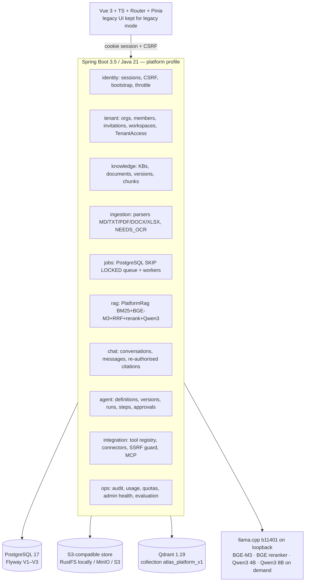

# Atlas AI Platform — architecture (feature/atlas-platform-v1)

## Shape: one modular monolith, two runtime modes

The same Spring Boot jar runs in one of two modes, selected by Spring profile:

| Mode | Activation | Storage | Purpose |
|---|---|---|---|
| **legacy** (default) | no profile | single JSON store, optional Qdrant | Today's production behaviour, byte-compatible. Kept so the current CD contract and rollback stay valid until cutover. |
| **platform** | `SPRING_PROFILES_ACTIVE=platform` | PostgreSQL + S3-compatible object store + Qdrant | Multi-tenant AI knowledge & agent platform (this branch). |

`ProfileDefaults` (an `EnvironmentPostProcessor`) disables the JDBC / Flyway / Spring Session auto-configuration unless the platform profile is
active, and every legacy bean carries `@Profile("!platform")`. All 47 legacy tests still pass unchanged. Platform resources live in
`backend/src/platform/resources` (Flyway migrations, `application-platform.properties`), **outside** the CD-protected `backend/src/main/resources`.

## Module boundaries (`dev.knowledge.platform.*`)

| Package | Responsibility | Key types |
|---|---|---|
| `core` | trace ids, JSON/DB helpers, profile defaults, SPA fallback | `TraceFilter`, `ProfileDefaults`, `SpaFallbackFilter` |
| `identity` | users, login/logout/register, password change + session revocation, bootstrap admin | `AuthController`, `CurrentUser`, `PlatformSecurityConfiguration`, `SessionRevoker` |
| `tenant` | organisations, memberships, invitations, workspaces; **the** authorisation entry point | `TenantAccess`, `OrgService`, `Role` |
| `knowledge` | knowledge bases, KB ACL, document lifecycle, canonical chunk endpoint | `KnowledgeBaseService`, `DocumentService` |
| `ingestion` | parsing, chunking, embedding, indexing, purge | `DocumentParser`, `IngestionHandler`, `PurgeHandler` |
| `jobs` | durable queue, leases, retries/backoff, cancel, idempotency, workers | `JobQueue`, `JobWorker`, `JobHandler` |
| `rag` | model gateway (local only, concurrency gate), Qdrant adapter, hybrid retrieval & grounded generation | `ModelGateway`, `PlatformRag`, `QdrantVectorStore` |
| `chat` | conversations, async answers, citation re-authorisation | `ChatService`, `ChatAnswerHandler` |
| `agent` | templates, versioned definitions, run executor, HITL approvals | `AgentService`, `AgentRunHandler`, `AgentModels` |
| `integration` | tool registry (read-only SQL templates, SSRF-safe HTTP GET, MCP adapter), connectors | `ToolRegistry`, `ConnectorService` |
| `ops` | audit trail, usage metering, quotas/rate limit, admin/health/evaluation APIs | `AuditService`, `UsageService`, `OpsController` |
| `migration` | legacy JSON store → platform importer with verification report | `LegacyStoreImporter` |

## Key flows

**Upload → READY.** `DocumentService.upload` validates name + extension + magic bytes (+ zip inspection for Office files), stores the original
bytes under a server-generated key, inserts `document_versions` (`STORED`) and enqueues `INGEST_VERSION` in the same transaction.
`IngestionHandler` re-checks the SHA-256, parses (`PARSING`), writes chunks (`CHUNKING`), embeds in batches with cancel checkpoints
(`EMBEDDING`), upserts Qdrant points carrying only ids (`INDEXING`), then in **one transaction** makes the version current and supersedes the
previous one. A failing new version never disturbs the current READY version. Superseded vectors are deleted after the switch.

**Question → answer.** `ChatService.post` checks quota/rate, stores the user message and a `PENDING` assistant message, enqueues
`CHAT_ANSWER`. The handler rebuilds the requester's tenant context *at execution time*, intersects the conversation's KBs with what the user can
read now, and runs `PlatformRag`: SQL candidate set (org, readable KBs, READY current versions, not expired/deleted) → BM25 over those chunks →
dense query filtered by `org_id` + the authorised version ids (and re-checked locally) → RRF (k=60) → BGE reranker with absolute/relative gates →
schema-constrained Qwen3 generation whose citations must be a subset of the reranked evidence. Citations store `(document, version, chunk, quote,
locator)`; every read re-authorises them (`CURRENT` / `SUPERSEDED` / `UNAVAILABLE`, answer text hidden when evidence became unavailable).

**Agent run.** Versioned definition → `workflow_runs` + `workflow_steps` → `AGENT_RUN` job. Steps: `RETRIEVE`, `LLM` (grounded answer or grounded
summary of prior step outputs), `EXTRACT` (deterministic regex over current chunks), `RULE`, `TOOL` (whitelisted read-only tools), `APPROVAL`
(pauses; resumes via a new job when approved), `OUTPUT` (`RUN`, or the single side-effecting `AGENT_OUTPUTS` write which requires an APPROVED
approval of the same run). Every tool call is recorded with tenant/run/step/trace.

## Concurrency and capacity
- Jobs: any number of app instances can run workers (`FOR UPDATE SKIP LOCKED`, leases, heartbeats). Crash → lease expiry → retried.
- Models: a fair semaphore (`atlas.models.max-concurrent-inference`, default 1) shared by chat, agents and ingestion. Queues absorb load;
  they do not increase CPU inference throughput.
- Lexical retrieval loads the authorised chunks per query (bounded at 50 000 chunks). Fine for the target scale (thousands of chunks per org);
  larger corpora need a persistent lexical index (e.g. PostgreSQL FTS with a CJK tokenizer) — documented as a known limit.

## What is deliberately not here (see IMPLEMENTATION_REPORT.md)
OCR engine, visual workflow editor, OIDC/SSO, multi-agent, GraphRAG, billing, PostgreSQL RLS (isolation is enforced in the service layer +
composite foreign keys + negative tests), persistent BM25 index.
