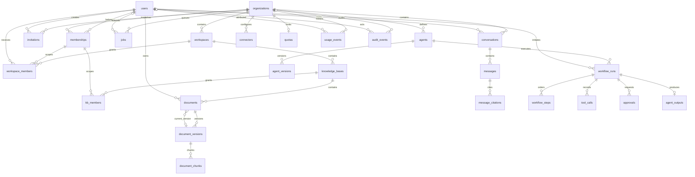

# Platform database schema

## Overview

PostgreSQL **15+ (tested on 17)** is the source of truth for identities, tenant authorization, document metadata/chunk text, jobs, chat and agent execution records. This describes the versioned Flyway migrations [V1 core](../../backend/src/platform/resources/db/migration/V1__platform_core.sql), [V2 sessions](../../backend/src/platform/resources/db/migration/V2__http_sessions.sql) and [V3 demo ERP](../../backend/src/platform/resources/db/migration/V3__demo_erp_readonly.sql): **30 application/framework/demo tables** (26 + 2 + 2). Flyway's own migration-history table is not defined by these scripts and is outside this inventory.

The tenant invariant is that every tenant-owned row carries `org_id`. Child-to-tenant-parent FKs include it alongside the parent key, normally `(org_id, id)` (membership parents use `(org_id, user_id)`), making cross-tenant links impossible **for those enforced relationships**. Global users, Spring Session and fictional demo ERP data are not tenant rows; audit events may have no organization. ID fields, arrays and JSON without FKs remain service-managed links, explicitly noted below; composite FKs do not replace authorization.

Original uploaded files live in object storage under server-generated keys `org/<org>/doc/<doc>/v<n>/<sha256>` (`ObjectStore.key`). Qdrant holds derived vectors with **IDs only in payload**: `org_id`, `kb_id`, `document_id`, `document_version_id`, `chunk_id`; it stores no document text. Queries are filtered by organization and allowed current-version IDs; canonical text comes from PostgreSQL (`QdrantVectorStore`, `PlatformRag`).

## Main relationships (V1)

The diagram shows principal declared FKs; ancillary creator/actor user links are enumerated in the table sections. No edge is implied for an ID without an FK. Cardinality describes SQL constraints, not required application provisioning.

## Column and constraint notation

Each table lists every migrated column. **Null = Yes** means SQL NULL is allowed, including implicit nullable columns; PK columns are non-null. **Default = -** means no declared default (nullable columns may consequently receive NULL). `bigserial` supplies an implicit sequence default. UUIDs have no SQL generation default; application code normally supplies them. **Check = -** means no column CHECK. PK/UNIQUE constraints create indexes; the separate index list contains additional explicitly created indexes only. Types/defaults/check expressions below follow the migrations.

FK entries reproduce the declared columns, targets and actions. Unless an entry says otherwise, deletion uses PostgreSQL's default NO ACTION, updates use NO ACTION, and the FK is NOT DEFERRABLE. `now()` defaults initialize timestamps on insertion; there are no automatic updated-at triggers in these migrations.

## Core tables (V1)

### `users`

Global login identities used by `UserRepository`; password hashes are BCrypt (`Passwords`).

| Column | Type | Null | Default | Check |
| --- | --- | --- | --- | --- |
| `id` | `uuid` | No | - | - |
| `email` | `varchar(254)` | No | - | - |
| `display_name` | `varchar(120)` | No | - | - |
| `password_hash` | `varchar(100)` | No | - | - |
| `status` | `varchar(16)` | No | `'ACTIVE'` | `status in ('ACTIVE','DISABLED')` |
| `system_role` | `varchar(16)` | No | `'NONE'` | `system_role in ('NONE','SYSTEM_ADMIN')` |
| `created_at` | `timestamptz` | No | `now()` | - |
| `password_changed_at` | `timestamptz` | No | `now()` | - |

**Keys / uniques:** `primary key (id)`.

**Additional indexes:** `create unique index users_email_unique on users (lower(email))`.

**FKs:** none.

**Invariant / service behavior:** Case-insensitive email uniqueness prevents duplicate login identities; status and system-role checks bound identity state. Users are global, not tenant rows.

### `organizations`

Tenant roots created by `OrgService`, with an initial owner membership, quota row and General workspace.

| Column | Type | Null | Default | Check |
| --- | --- | --- | --- | --- |
| `id` | `uuid` | No | - | - |
| `name` | `varchar(120)` | No | - | - |
| `slug` | `varchar(64)` | No | - | `slug ~ '^[a-z0-9][a-z0-9-]{1,63}$'` |
| `status` | `varchar(16)` | No | `'ACTIVE'` | `status in ('ACTIVE','SUSPENDED')` |
| `plan` | `varchar(32)` | No | `'SELF_HOSTED'` | - |
| `created_at` | `timestamptz` | No | `now()` | - |

**Keys / uniques:** `primary key (id)`; `unique (slug)`.

**Additional indexes:** none.

**FKs:** none.

**Invariant / service behavior:** Unique, format-checked slugs identify tenants; status gates access in `TenantAccess`. `plan` is free text, not an enum.

### `memberships`

Organization membership and organization-level RBAC (`OrgService`, `TenantAccess`).

| Column | Type | Null | Default | Check |
| --- | --- | --- | --- | --- |
| `org_id` | `uuid` | No | - | - |
| `user_id` | `uuid` | No | - | - |
| `role` | `varchar(16)` | No | - | `role in ('OWNER','ADMIN','EDITOR','VIEWER')` |
| `status` | `varchar(16)` | No | `'ACTIVE'` | `status in ('ACTIVE','DISABLED')` |
| `created_at` | `timestamptz` | No | `now()` | - |

**Keys / uniques:** `primary key (org_id, user_id)`.

**Additional indexes:** `create index memberships_user on memberships(user_id)`.

**FKs:** `org_id references organizations(id) on delete cascade`; `user_id references users(id) on delete cascade`.

**Invariant / service behavior:** One membership per organization/user; both parents must exist. Roles and statuses are bounded by checks. Keeping at least one active OWNER is a service rule, not a SQL constraint.

### `invitations`

Email invitations issued, revoked and accepted by `OrgService`.

| Column | Type | Null | Default | Check |
| --- | --- | --- | --- | --- |
| `id` | `uuid` | No | - | - |
| `org_id` | `uuid` | No | - | - |
| `email` | `varchar(254)` | No | - | - |
| `role` | `varchar(16)` | No | - | `role in ('ADMIN','EDITOR','VIEWER')` |
| `token_hash` | `char(64)` | No | - | - |
| `expires_at` | `timestamptz` | No | - | - |
| `accepted_at` | `timestamptz` | Yes | - | - |
| `revoked_at` | `timestamptz` | Yes | - | - |
| `created_by` | `uuid` | No | - | - |
| `created_at` | `timestamptz` | No | `now()` | - |

**Keys / uniques:** `primary key (id)`; `unique (token_hash)`.

**Additional indexes:** none.

**FKs:** `org_id references organizations(id) on delete cascade`; `created_by references users(id)`.

**Invariant / service behavior:** Only the SHA-256 hash of the random invitation token is persisted in `token_hash`; the raw token is returned on creation. SQL enforces uniqueness/length, not SHA-256 encoding. Service checks email, expiry and accepted/revoked state; OWNER cannot be invited.

### `workspaces`

Named organization workspaces used by `OrgService` and KB access management.

| Column | Type | Null | Default | Check |
| --- | --- | --- | --- | --- |
| `id` | `uuid` | No | - | - |
| `org_id` | `uuid` | No | - | - |
| `name` | `varchar(120)` | No | - | - |
| `description` | `varchar(500)` | No | `''` | - |
| `created_at` | `timestamptz` | No | `now()` | - |

**Keys / uniques:** `primary key (id)`; `unique (org_id, id)`; `unique (org_id, name)`.

**Additional indexes:** none.

**FKs:** `org_id references organizations(id) on delete cascade`.

**Invariant / service behavior:** Names are unique within an organization; `(org_id, id)` supports tenant-safe child references.

### `workspace_members`

Explicit workspace roles used by `TenantAccess` to compute KB access.

| Column | Type | Null | Default | Check |
| --- | --- | --- | --- | --- |
| `org_id` | `uuid` | No | - | - |
| `workspace_id` | `uuid` | No | - | - |
| `user_id` | `uuid` | No | - | - |
| `role` | `varchar(16)` | No | - | `role in ('MANAGER','EDITOR','VIEWER')` |

**Keys / uniques:** `primary key (workspace_id, user_id)`.

**Additional indexes:** none.

**FKs:** `user_id references users(id) on delete cascade`; `foreign key (org_id, workspace_id) references workspaces(org_id, id) on delete cascade`; `foreign key (org_id, user_id) references memberships(org_id, user_id) on delete cascade`.

**Invariant / service behavior:** Composite FKs require both the workspace and organization membership to belong to the same tenant. The PK permits only one role per workspace/user.

### `knowledge_bases`

Workspace document collections managed by `KnowledgeBaseService`; `TenantAccess` resolves effective access.

| Column | Type | Null | Default | Check |
| --- | --- | --- | --- | --- |
| `id` | `uuid` | No | - | - |
| `org_id` | `uuid` | No | - | - |
| `workspace_id` | `uuid` | No | - | - |
| `name` | `varchar(120)` | No | - | - |
| `description` | `varchar(1000)` | No | `''` | - |
| `visibility` | `varchar(16)` | No | `'ORG'` | `visibility in ('ORG','RESTRICTED')` |
| `created_by` | `uuid` | No | - | - |
| `created_at` | `timestamptz` | No | `now()` | - |
| `deleted_at` | `timestamptz` | Yes | - | - |

**Keys / uniques:** `primary key (id)`; `unique (org_id, id)`.

**Additional indexes:** none.

**FKs:** `created_by references users(id)`; `foreign key (org_id, workspace_id) references workspaces(org_id, id) on delete cascade`.

**Invariant / service behavior:** Composite workspace FK prevents cross-tenant placement. ORG visibility grants active org members access; RESTRICTED access uses organization admins and explicit workspace/KB roles. Visibility enforcement and exclusion of soft-deleted KBs are service rules.

### `kb_members`

Explicit KB editor/viewer grants managed by `KnowledgeBaseService`.

| Column | Type | Null | Default | Check |
| --- | --- | --- | --- | --- |
| `org_id` | `uuid` | No | - | - |
| `kb_id` | `uuid` | No | - | - |
| `user_id` | `uuid` | No | - | - |
| `role` | `varchar(16)` | No | - | `role in ('EDITOR','VIEWER')` |

**Keys / uniques:** `primary key (kb_id, user_id)`.

**Additional indexes:** none.

**FKs:** `foreign key (org_id, kb_id) references knowledge_bases(org_id, id) on delete cascade`; `foreign key (org_id, user_id) references memberships(org_id, user_id) on delete cascade`.

**Invariant / service behavior:** Composite FKs require a KB and organization membership in the same tenant, with one grant per KB/user. Effective permissions are computed by `TenantAccess`.

### `documents`

Stable document identity, ownership and metadata managed by `DocumentService`; current version selects the searchable content.

| Column | Type | Null | Default | Check |
| --- | --- | --- | --- | --- |
| `id` | `uuid` | No | - | - |
| `org_id` | `uuid` | No | - | - |
| `kb_id` | `uuid` | No | - | - |
| `title` | `varchar(200)` | No | - | - |
| `owner_id` | `uuid` | No | - | - |
| `status` | `varchar(16)` | No | - | `status in ('PROCESSING','READY','FAILED','NEEDS_OCR','CANCELLED','DELETING')` |
| `current_version_id` | `uuid` | Yes | - | - |
| `latest_version_no` | `int` | No | `0` | - |
| `expires_at` | `timestamptz` | Yes | - | - |
| `tags` | `text[]` | No | `'{}'` | - |
| `legacy_id` | `varchar(64)` | Yes | - | - |
| `created_at` | `timestamptz` | No | `now()` | - |
| `updated_at` | `timestamptz` | No | `now()` | - |
| `deleted_at` | `timestamptz` | Yes | - | - |

**Keys / uniques:** `primary key (id)`; `unique (org_id, id)`.

**Additional indexes:** `create index documents_kb on documents(org_id, kb_id) where deleted_at is null`; `create unique index documents_legacy on documents(org_id, legacy_id) where legacy_id is not null`.

**FKs:** `owner_id references users(id)`; `foreign key (org_id, kb_id) references knowledge_bases(org_id, id) on delete cascade`; `constraint documents_current_version foreign key (org_id, current_version_id) references document_versions(org_id, id) deferrable initially deferred`.

**Invariant / service behavior:** Composite KB FK protects tenant placement. `documents_current_version` is DEFERRABLE INITIALLY DEFERRED, allowing transactional updates of the cyclic document/version relationship. It enforces the same organization, but does not prove that the selected version belongs to this particular document or is READY; services enforce those rules. `latest_version_no` has no nonnegative CHECK. Replacement uploads leave an existing current version available until the final indexing switch.

### `document_versions`

Per-upload file metadata and ingestion state (`DocumentService`, `IngestionHandler`); original bytes live in object storage.

| Column | Type | Null | Default | Check |
| --- | --- | --- | --- | --- |
| `id` | `uuid` | No | - | - |
| `org_id` | `uuid` | No | - | - |
| `document_id` | `uuid` | No | - | - |
| `version_no` | `int` | No | - | `version_no > 0` |
| `sha256` | `char(64)` | No | - | - |
| `object_key` | `varchar(300)` | No | - | - |
| `filename` | `varchar(255)` | No | - | - |
| `mime_type` | `varchar(120)` | No | - | - |
| `size_bytes` | `bigint` | No | - | `size_bytes >= 0` |
| `parser_version` | `varchar(40)` | Yes | - | - |
| `pipeline_state` | `varchar(16)` | No | - | `pipeline_state in ('RECEIVED','VALIDATING','STORED','PARSING','CHUNKING','EMBEDDING','INDEXING','READY','FAILED','NEEDS_OCR','CANCELLED','SUPERSEDED')` |
| `error_code` | `varchar(64)` | Yes | - | - |
| `error_message` | `varchar(500)` | Yes | - | - |
| `page_count` | `int` | Yes | - | - |
| `chunk_count` | `int` | No | `0` | - |
| `job_id` | `uuid` | Yes | - | - |
| `created_by` | `uuid` | No | - | - |
| `created_at` | `timestamptz` | No | `now()` | - |
| `ready_at` | `timestamptz` | Yes | - | - |

**Keys / uniques:** `primary key (id)`; `unique (document_id, version_no)`; `unique (org_id, id)`.

**Additional indexes:** none.

**FKs:** `created_by references users(id)`; `foreign key (org_id, document_id) references documents(org_id, id) on delete cascade`.

**Invariant / service behavior:** Version numbers are positive and unique per document; size is nonnegative. Normal execution is RECEIVED -> STORED -> PARSING -> CHUNKING -> EMBEDDING -> INDEXING -> READY; VALIDATING is allowed by SQL but is not a separate persisted phase in these handlers. FAILED, NEEDS_OCR and CANCELLED describe unsuccessful/interrupted processing; SUPERSEDED marks replaced versions. Checks bound state values, not transitions. `IngestionHandler` switches the current version atomically after vector writes and supersedes the prior version. `job_id` is an application-managed reference with no FK; hashes have no SQL hex-format check.

### `document_chunks`

Canonical parsed chunk text, heading, content hash and provable source locator; written by ingestion and read by retrieval/citation APIs.

| Column | Type | Null | Default | Check |
| --- | --- | --- | --- | --- |
| `org_id` | `uuid` | No | - | - |
| `document_version_id` | `uuid` | No | - | - |
| `chunk_id` | `varchar(120)` | No | - | - |
| `ordinal` | `int` | No | - | - |
| `heading` | `varchar(500)` | No | `''` | - |
| `content` | `text` | No | - | - |
| `content_hash` | `char(64)` | No | - | - |
| `locator` | `jsonb` | No | `'{}'::jsonb` | - |

**Keys / uniques:** `primary key (document_version_id, chunk_id)`.

**Additional indexes:** `create index document_chunks_org on document_chunks(org_id, document_version_id)`.

**FKs:** `foreign key (org_id, document_version_id) references document_versions(org_id, id) on delete cascade`.

**Invariant / service behavior:** Composite version FK prevents cross-tenant chunks; `(document_version_id, chunk_id)` identifies a chunk within a version. Locator JSON can contain page, lineStart, lineEnd, sheet or row when supported by the parser; SQL imposes no locator schema or ordinal/hash-format CHECK.

### `jobs`

Durable queue for INGEST_VERSION, PURGE_DOCUMENT, CHAT_ANSWER and AGENT_RUN (`JobQueue`, handlers).

| Column | Type | Null | Default | Check |
| --- | --- | --- | --- | --- |
| `id` | `uuid` | No | - | - |
| `org_id` | `uuid` | No | - | - |
| `type` | `varchar(32)` | No | - | - |
| `state` | `varchar(16)` | No | - | `state in ('QUEUED','RUNNING','SUCCEEDED','FAILED','CANCELLED')` |
| `payload` | `jsonb` | No | - | - |
| `result` | `jsonb` | Yes | - | - |
| `attempts` | `int` | No | `0` | - |
| `max_attempts` | `int` | No | `3` | - |
| `priority` | `int` | No | `100` | - |
| `run_after` | `timestamptz` | No | `now()` | - |
| `lease_owner` | `varchar(80)` | Yes | - | - |
| `lease_until` | `timestamptz` | Yes | - | - |
| `idempotency_key` | `varchar(120)` | Yes | - | - |
| `cancel_requested` | `boolean` | No | `false` | - |
| `last_error` | `varchar(500)` | Yes | - | - |
| `created_by` | `uuid` | Yes | - | - |
| `trace_id` | `varchar(64)` | No | - | - |
| `created_at` | `timestamptz` | No | `now()` | - |
| `updated_at` | `timestamptz` | No | `now()` | - |

**Keys / uniques:** `primary key (id)`; `unique (org_id, id)`.

**Additional indexes:** `create unique index jobs_idempotency on jobs(org_id, type, idempotency_key) where idempotency_key is not null`; `create index jobs_ready on jobs(state, run_after, priority) where state in ('QUEUED','RUNNING')`.

**FKs:** `org_id references organizations(id) on delete cascade`; `created_by references users(id)`.

**Invariant / service behavior:** `jobs_idempotency` is unique on `(org_id, type, idempotency_key)` whenever the key is non-null, across ALL states, including finished jobs. It is not an active-job-only constraint. `JobQueue` uses FOR UPDATE SKIP LOCKED, expiring leases, bounded retries/backoff and cooperative cancellation; these behaviors are application logic. `type`, attempt counts and priority have no CHECK.

### `conversations`

Private chat threads selected by organization and author (`ChatService`); `kb_ids` holds the selected KB scope.

| Column | Type | Null | Default | Check |
| --- | --- | --- | --- | --- |
| `id` | `uuid` | No | - | - |
| `org_id` | `uuid` | No | - | - |
| `user_id` | `uuid` | No | - | - |
| `title` | `varchar(200)` | No | - | - |
| `kb_ids` | `uuid[]` | No | `'{}'` | - |
| `created_at` | `timestamptz` | No | `now()` | - |
| `updated_at` | `timestamptz` | No | `now()` | - |
| `deleted_at` | `timestamptz` | Yes | - | - |

**Keys / uniques:** `primary key (id)`; `unique (org_id, id)`.

**Additional indexes:** `create index conversations_user on conversations(org_id, user_id, updated_at desc) where deleted_at is null`.

**FKs:** `org_id references organizations(id) on delete cascade`; `user_id references users(id) on delete cascade`.

**Invariant / service behavior:** Organization and user must exist; ownership, readable KB selection and soft-delete filtering are enforced by the service. UUID array elements have no FK, and `(org_id, user_id)` is not constrained to memberships here.

### `messages`

Persisted user questions and asynchronous assistant replies (`ChatService`, `ChatAnswerHandler`).

| Column | Type | Null | Default | Check |
| --- | --- | --- | --- | --- |
| `id` | `uuid` | No | - | - |
| `org_id` | `uuid` | No | - | - |
| `conversation_id` | `uuid` | No | - | - |
| `role` | `varchar(16)` | No | - | `role in ('USER','ASSISTANT')` |
| `content` | `text` | No | - | - |
| `status` | `varchar(16)` | No | - | `status in ('COMPLETE','PENDING','REFUSED','FAILED')` |
| `job_id` | `uuid` | Yes | - | - |
| `model` | `varchar(100)` | Yes | - | - |
| `meta` | `jsonb` | No | `'{}'::jsonb` | - |
| `created_at` | `timestamptz` | No | `now()` | - |

**Keys / uniques:** `primary key (id)`; `unique (org_id, id)`.

**Additional indexes:** `create index messages_conversation on messages(conversation_id, created_at)`.

**FKs:** `foreign key (org_id, conversation_id) references conversations(org_id, id) on delete cascade`.

**Invariant / service behavior:** Composite conversation FK prevents cross-tenant messages. Role/status checks bound message kinds and outcomes; `job_id` has no FK. Service persists PENDING replies and later COMPLETE, REFUSED or FAILED results.

### `message_citations`

Ordered snapshots of retrieved evidence, saved with assistant replies by `ChatAnswerHandler`.

| Column | Type | Null | Default | Check |
| --- | --- | --- | --- | --- |
| `org_id` | `uuid` | No | - | - |
| `message_id` | `uuid` | No | - | - |
| `ordinal` | `int` | No | - | - |
| `document_id` | `uuid` | No | - | - |
| `document_version_id` | `uuid` | No | - | - |
| `version_no` | `int` | No | - | - |
| `chunk_id` | `varchar(120)` | No | - | - |
| `title` | `varchar(200)` | No | - | - |
| `quote` | `text` | No | - | - |
| `locator` | `jsonb` | No | `'{}'::jsonb` | - |

**Keys / uniques:** `primary key (message_id, ordinal)`.

**Additional indexes:** none.

**FKs:** `foreign key (org_id, message_id) references messages(org_id, id) on delete cascade`.

**Invariant / service behavior:** Composite message FK prevents cross-tenant attachment. Document, version and chunk identifiers are snapshots with no source FKs, so citations survive chunk purging. `ChatService` rechecks document access/expiry/deletion on reads and reports CURRENT, SUPERSEDED or UNAVAILABLE; these are computed states, not columns.

### `agents`

Organization-scoped agent configuration, template and current definition version (`AgentService`).

| Column | Type | Null | Default | Check |
| --- | --- | --- | --- | --- |
| `id` | `uuid` | No | - | - |
| `org_id` | `uuid` | No | - | - |
| `name` | `varchar(120)` | No | - | - |
| `template` | `varchar(32)` | No | - | `template in ('KNOWLEDGE_QA','DOCUMENT_COMPARE','READONLY_TOOL')` |
| `description` | `varchar(1000)` | No | `''` | - |
| `enabled` | `boolean` | No | `true` | - |
| `current_version` | `int` | No | `1` | - |
| `created_by` | `uuid` | No | - | - |
| `created_at` | `timestamptz` | No | `now()` | - |
| `updated_at` | `timestamptz` | No | `now()` | - |

**Keys / uniques:** `primary key (id)`; `unique (org_id, id)`.

**Additional indexes:** none.

**FKs:** `org_id references organizations(id) on delete cascade`; `created_by references users(id)`.

**Invariant / service behavior:** Template CHECK limits the supported agent families. `current_version` is an application-managed pointer, without an FK or positive-value CHECK. Agent configuration validation and access checks are service logic.

### `agent_versions`

Versioned JSON definitions inserted by `AgentService`; runs load the definition version they started with.

| Column | Type | Null | Default | Check |
| --- | --- | --- | --- | --- |
| `org_id` | `uuid` | No | - | - |
| `agent_id` | `uuid` | No | - | - |
| `version_no` | `int` | No | - | - |
| `definition` | `jsonb` | No | - | - |
| `created_by` | `uuid` | No | - | - |
| `created_at` | `timestamptz` | No | `now()` | - |

**Keys / uniques:** `primary key (agent_id, version_no)`.

**Additional indexes:** none.

**FKs:** `created_by references users(id)`; `foreign key (org_id, agent_id) references agents(org_id, id) on delete cascade`.

**Invariant / service behavior:** One version number per agent and a composite FK to the tenant-scoped agent. Definitions are treated as immutable by the service, with no database immutability trigger or positive version CHECK. JSON KB/tool/step settings are validated by the service, not SQL.

### `workflow_runs`

Durable execution instances pinned to `agent_version`, with actor, input/output and trace (`AgentService`, `AgentRunHandler`).

| Column | Type | Null | Default | Check |
| --- | --- | --- | --- | --- |
| `id` | `uuid` | No | - | - |
| `org_id` | `uuid` | No | - | - |
| `agent_id` | `uuid` | No | - | - |
| `agent_version` | `int` | No | - | - |
| `actor_id` | `uuid` | No | - | - |
| `status` | `varchar(24)` | No | - | `status in ('QUEUED','RUNNING','WAITING_APPROVAL','SUCCEEDED','FAILED','REJECTED','CANCELLED')` |
| `input` | `jsonb` | No | - | - |
| `output` | `jsonb` | Yes | - | - |
| `error` | `varchar(500)` | Yes | - | - |
| `trace_id` | `varchar(64)` | No | - | - |
| `created_at` | `timestamptz` | No | `now()` | - |
| `updated_at` | `timestamptz` | No | `now()` | - |

**Keys / uniques:** `primary key (id)`; `unique (org_id, id)`.

**Additional indexes:** `create index workflow_runs_agent on workflow_runs(org_id, agent_id, created_at desc)`.

**FKs:** `actor_id references users(id)`; `foreign key (org_id, agent_id) references agents(org_id, id) on delete cascade`.

**Invariant / service behavior:** Composite agent FK prevents cross-tenant runs; status CHECK bounds outcomes. `agent_version` has no FK to `agent_versions`. The handler reloads the pinned definition and rebuilds actor authorization when work executes.

### `workflow_steps`

Ordered execution timeline with per-step state, output, errors and timestamps (`AgentRunHandler`).

| Column | Type | Null | Default | Check |
| --- | --- | --- | --- | --- |
| `id` | `uuid` | No | - | - |
| `org_id` | `uuid` | No | - | - |
| `run_id` | `uuid` | No | - | - |
| `ordinal` | `int` | No | - | - |
| `type` | `varchar(24)` | No | - | - |
| `name` | `varchar(120)` | No | - | - |
| `status` | `varchar(24)` | No | - | `status in ('PENDING','RUNNING','SUCCEEDED','FAILED','WAITING_APPROVAL','REJECTED','SKIPPED','CANCELLED')` |
| `output` | `jsonb` | Yes | - | - |
| `error` | `varchar(500)` | Yes | - | - |
| `started_at` | `timestamptz` | Yes | - | - |
| `finished_at` | `timestamptz` | Yes | - | - |

**Keys / uniques:** `primary key (id)`; `unique (run_id, ordinal)`; `unique (org_id, id)`.

**Additional indexes:** none.

**FKs:** `foreign key (org_id, run_id) references workflow_runs(org_id, id) on delete cascade`.

**Invariant / service behavior:** Unique `(run_id, ordinal)` prevents duplicate step positions; composite run FK prevents cross-tenant attachment. The service validates step types (RETRIEVE, LLM, EXTRACT, RULE, TOOL, APPROVAL, OUTPUT); SQL only checks status, not `type` or ordinal range.

### `connectors`

Per-organization HTTP_GET, SQL_READONLY or MCP configuration (`ConnectorService`, `ToolRegistry`).

| Column | Type | Null | Default | Check |
| --- | --- | --- | --- | --- |
| `id` | `uuid` | No | - | - |
| `org_id` | `uuid` | No | - | - |
| `type` | `varchar(24)` | No | - | `type in ('HTTP_GET','SQL_READONLY','MCP')` |
| `name` | `varchar(120)` | No | - | - |
| `config` | `jsonb` | No | - | - |
| `secret_ref` | `varchar(120)` | Yes | - | - |
| `enabled` | `boolean` | No | `true` | - |
| `created_by` | `uuid` | No | - | - |
| `created_at` | `timestamptz` | No | `now()` | - |

**Keys / uniques:** `primary key (id)`; `unique (org_id, id)`; `unique (org_id, name)`.

**Additional indexes:** none.

**FKs:** `org_id references organizations(id) on delete cascade`; `created_by references users(id)`.

**Invariant / service behavior:** `config` is intended to hold no secrets; `secret_ref` names a server environment variable, validated as `ATLAS_CONNECTOR_[A-Z0-9_]{1,80}`. HTTP GET resolves that name at execution time. Secret/config validation and endpoint/tool allow-lists are service controls, not SQL checks; the JSON column itself cannot guarantee secrecy. Names are unique per organization.

### `tool_calls`

Execution/denial records written by `AgentRunHandler`, including tool name, side-effect flag and request/response.

| Column | Type | Null | Default | Check |
| --- | --- | --- | --- | --- |
| `id` | `uuid` | No | - | - |
| `org_id` | `uuid` | No | - | - |
| `run_id` | `uuid` | No | - | - |
| `step_id` | `uuid` | Yes | - | - |
| `tool` | `varchar(80)` | No | - | - |
| `side_effect` | `boolean` | No | - | - |
| `request` | `jsonb` | No | - | - |
| `response` | `jsonb` | Yes | - | - |
| `status` | `varchar(16)` | No | - | `status in ('SUCCEEDED','FAILED','DENIED')` |
| `created_at` | `timestamptz` | No | `now()` | - |

**Keys / uniques:** `primary key (id)`.

**Additional indexes:** none.

**FKs:** `foreign key (org_id, run_id) references workflow_runs(org_id, id) on delete cascade`.

**Invariant / service behavior:** Composite run FK protects tenant attachment; status CHECK distinguishes success, failure and denial. `step_id` has no FK and `tool` is not an SQL enum; tool allow-lists and approval requirements are enforced by the executor.

### `approvals`

Human review requests and decisions used to pause/resume/reject workflow runs (`AgentService`, `AgentRunHandler`).

| Column | Type | Null | Default | Check |
| --- | --- | --- | --- | --- |
| `id` | `uuid` | No | - | - |
| `org_id` | `uuid` | No | - | - |
| `run_id` | `uuid` | No | - | - |
| `step_id` | `uuid` | No | - | - |
| `status` | `varchar(16)` | No | - | `status in ('PENDING','APPROVED','REJECTED','CANCELLED')` |
| `summary` | `varchar(500)` | No | - | - |
| `payload` | `jsonb` | No | - | - |
| `requested_by` | `uuid` | No | - | - |
| `decided_by` | `uuid` | Yes | - | - |
| `decided_at` | `timestamptz` | Yes | - | - |
| `comment` | `varchar(500)` | Yes | - | - |
| `created_at` | `timestamptz` | No | `now()` | - |

**Keys / uniques:** `primary key (id)`; `unique (org_id, id)`.

**Additional indexes:** `create index approvals_pending on approvals(org_id, status, created_at)`.

**FKs:** `requested_by references users(id)`; `decided_by references users(id)`; `foreign key (org_id, run_id) references workflow_runs(org_id, id) on delete cascade`.

**Invariant / service behavior:** Composite run FK protects tenant attachment and the status CHECK bounds decisions. `step_id` has no FK. The service restricts decisions to eligible reviewers, disallows non-admin self-approval and accepts only PENDING decisions. SQL does not enforce those rules or timestamp consistency.

### `agent_outputs`

Internal result records written by the controlled OUTPUT step after human approval (`AgentRunHandler`).

| Column | Type | Null | Default | Check |
| --- | --- | --- | --- | --- |
| `id` | `uuid` | No | - | - |
| `org_id` | `uuid` | No | - | - |
| `run_id` | `uuid` | No | - | - |
| `approval_id` | `uuid` | No | - | - |
| `payload` | `jsonb` | No | - | - |
| `created_at` | `timestamptz` | No | `now()` | - |

**Keys / uniques:** `primary key (id)`; `unique (run_id)`.

**Additional indexes:** none.

**FKs:** `foreign key (org_id, run_id) references workflow_runs(org_id, id) on delete cascade`.

**Invariant / service behavior:** Unique `run_id` makes result recording idempotent per run; composite run FK prevents cross-tenant placement. `approval_id` has no FK: the handler requires an APPROVED approval in the same run plus the `output.record` tool grant. Approval authorization is not guaranteed by SQL alone.

### `quotas`

One row of organization limits used by `UsageService` admission control and reporting.

| Column | Type | Null | Default | Check |
| --- | --- | --- | --- | --- |
| `org_id` | `uuid` | No | - | - |
| `monthly_token_limit` | `bigint` | No | `2000000` | - |
| `monthly_request_limit` | `int` | No | `5000` | - |
| `requests_per_minute` | `int` | No | `30` | - |
| `updated_at` | `timestamptz` | No | `now()` | - |

**Keys / uniques:** `primary key (org_id)`.

**Additional indexes:** none.

**FKs:** `org_id references organizations(id) on delete cascade`.

**Invariant / service behavior:** The organization PK/FK permits at most one quota row per tenant. Monthly token/request limits and per-minute request limits are evaluated by the service; zero monthly limits mean unlimited. Numeric bounds are service validation, with no SQL CHECK.

### `usage_events`

Request/token/latency metering recorded by `UsageService`, aggregated by organization, user, model, agent and UTC day.

| Column | Type | Null | Default | Check |
| --- | --- | --- | --- | --- |
| `id` | `bigserial` | No | `implicit sequence` | - |
| `org_id` | `uuid` | No | - | - |
| `user_id` | `uuid` | Yes | - | - |
| `agent_id` | `uuid` | Yes | - | - |
| `kind` | `varchar(32)` | No | - | - |
| `model` | `varchar(100)` | Yes | - | - |
| `input_tokens` | `int` | No | `0` | - |
| `output_tokens` | `int` | No | `0` | - |
| `latency_ms` | `bigint` | No | `0` | - |
| `status` | `varchar(16)` | No | - | - |
| `trace_id` | `varchar(64)` | Yes | - | - |
| `created_at` | `timestamptz` | No | `now()` | - |

**Keys / uniques:** `primary key (id)`.

**Additional indexes:** `create index usage_events_org_time on usage_events(org_id, created_at)`.

**FKs:** `org_id references organizations(id) on delete cascade`; `user_id references users(id) on delete set null`.

**Invariant / service behavior:** Organization FK scopes events; user deletion preserves the event with a null user. `agent_id` has no FK. `kind`, `status`, token counts and latency have no CHECK; the schema does not encode currency or pricing.

### `audit_events`

Security/operations audit trail appended by `AuditService`, carrying identifiers, request/trace correlation and small non-secret details.

| Column | Type | Null | Default | Check |
| --- | --- | --- | --- | --- |
| `id` | `bigserial` | No | `implicit sequence` | - |
| `org_id` | `uuid` | Yes | - | - |
| `actor_id` | `uuid` | Yes | - | - |
| `action` | `varchar(64)` | No | - | - |
| `resource_type` | `varchar(40)` | Yes | - | - |
| `resource_id` | `varchar(80)` | Yes | - | - |
| `result` | `varchar(16)` | No | - | `result in ('SUCCESS','DENIED','FAILURE')` |
| `request_id` | `varchar(64)` | Yes | - | - |
| `trace_id` | `varchar(64)` | Yes | - | - |
| `ip` | `varchar(64)` | Yes | - | - |
| `detail` | `jsonb` | No | `'{}'::jsonb` | - |
| `created_at` | `timestamptz` | No | `now()` | - |

**Keys / uniques:** `primary key (id)`.

**Additional indexes:** `create index audit_events_org_time on audit_events(org_id, created_at desc)`.

**FKs:** `org_id references organizations(id) on delete cascade`; `actor_id references users(id) on delete set null`.

**Invariant / service behavior:** Result CHECK bounds outcomes. Nullable `org_id` supports global/denied access events; actor deletion retains the event with a null actor. Append-only is an application convention, not a trigger or database privilege restriction; organization deletion would cascade these rows.

## Spring Session (V2)

These two framework tables persist server sessions and are separate from tenant content. There are no explicit column defaults or CHECK constraints in V2.

### `spring_session`

Spring Session JDBC persistence for sign-ins across restarts; `SessionRevoker` finds sessions by user UUID principal name and deletes them server-side.

| Column | Type | Null | Default | Check |
| --- | --- | --- | --- | --- |
| `primary_id` | `char(36)` | No | - | - |
| `session_id` | `char(36)` | No | - | - |
| `creation_time` | `bigint` | No | - | - |
| `last_access_time` | `bigint` | No | - | - |
| `max_inactive_interval` | `int` | No | - | - |
| `expiry_time` | `bigint` | No | - | - |
| `principal_name` | `varchar(100)` | Yes | - | - |

**Keys / uniques:** `constraint spring_session_pk primary key (primary_id)`.

**Additional indexes:** `create unique index spring_session_ix1 on spring_session (session_id)`; `create index spring_session_ix2 on spring_session (expiry_time)`; `create index spring_session_ix3 on spring_session (principal_name)`.

**FKs:** none.

**Invariant / service behavior:** Unique `session_id` distinguishes public session identifiers from internal `primary_id`; expiry/principal indexes support session lookup/cleanup. Global framework data: no `org_id`, user FK or CHECK constraints.

### `spring_session_attributes`

Serialized Spring Session attributes attached to the internal session key.

| Column | Type | Null | Default | Check |
| --- | --- | --- | --- | --- |
| `session_primary_id` | `char(36)` | No | - | - |
| `attribute_name` | `varchar(200)` | No | - | - |
| `attribute_bytes` | `bytea` | No | - | - |

**Keys / uniques:** `constraint spring_session_attributes_pk primary key (session_primary_id, attribute_name)`.

**Additional indexes:** none.

**FKs:** `constraint spring_session_attributes_fk foreign key (session_primary_id) references spring_session(primary_id) on delete cascade`.

**Invariant / service behavior:** One value per session/attribute name; session deletion cascades attributes. `attribute_bytes` is binary framework session data, not document storage. No CHECK constraints.

## Fictional demo ERP (V3)

The `demo_erp` schema contains only fictional seeded demo data, used only by read-only agent tools. It is not tenant business data. `ToolRegistry` exposes `sql.part_lookup`, `sql.inventory_by_part` and `sql.parts_by_category`; configured SQL_READONLY connectors also use SELECT queries over this schema. All tool SQL runs in READ ONLY transactions (3-second statement timeout); model output is never executed as SQL. V3 sets no column defaults or CHECK constraints.

### `demo_erp.parts`

Fictional part catalog seeded by V3 (five rows), used only by read-only agent tools; not tenant or production ERP data.

| Column | Type | Null | Default | Check |
| --- | --- | --- | --- | --- |
| `part_no` | `varchar(32)` | No | - | - |
| `name` | `varchar(120)` | No | - | - |
| `category` | `varchar(60)` | No | - | - |
| `voltage_min` | `numeric(6,2)` | Yes | - | - |
| `voltage_max` | `numeric(6,2)` | Yes | - | - |
| `temp_min_c` | `int` | Yes | - | - |
| `temp_max_c` | `int` | Yes | - | - |
| `lead_time_days` | `int` | No | - | - |
| `unit_price_twd` | `numeric(12,2)` | No | - | - |

**Keys / uniques:** `primary key (part_no)`.

**Additional indexes:** none.

**FKs:** none.

**Invariant / service behavior:** Part numbers identify demo items; SQL defines no range, price or lead-time CHECK. `ToolRegistry` uses named parameterized SELECT templates; connector-defined queries are restricted to single SELECT statements over demo_erp.

### `demo_erp.inventory`

Fictional per-warehouse part stock seeded by V3 (six rows), used only by read-only agent tools.

| Column | Type | Null | Default | Check |
| --- | --- | --- | --- | --- |
| `part_no` | `varchar(32)` | No | - | - |
| `warehouse` | `varchar(32)` | No | - | - |
| `on_hand` | `int` | No | - | - |

**Keys / uniques:** `primary key (part_no, warehouse)`.

**Additional indexes:** none.

**FKs:** `part_no references demo_erp.parts(part_no)`.

**Invariant / service behavior:** One stock row per part/warehouse; part FK requires a catalog entry. No tenant identifier or nonnegative stock CHECK. Tool SQL runs in READ ONLY transactions with a local statement timeout; no model-written SQL is executed.

## Retention and deletion as implemented

- **Documents:** `DocumentService.delete` sets `deleted_at` and status DELETING immediately and queues PURGE_DOCUMENT. `PurgeHandler` checks the soft-delete flag, removes document vectors, original files for all versions and all version chunks, then clears `current_version_id`. Document/version metadata remains; READY or SUPERSEDED versions become SUPERSEDED, other states become CANCELLED. This is asynchronous purging, not a hard delete or a complete erasure of every derived record. Citation snapshots and stored chat answers are retained; `ChatService` reauthorizes their reads and hides inaccessible citations and associated answer text. KB deletion also soft-deletes its documents for purge.
- **Expiry and supersession:** expiry is checked by retrieval/citation access; it is not an automatic deletion schedule. Successful replacement switches the current version only after indexing; superseded vectors are removed after the switch. Old version metadata, chunks and files remain until document purge.
- **Conversations:** `ChatService.delete` sets `deleted_at`; messages and citation snapshots remain in PostgreSQL, excluded through conversation ownership/live-row checks. No conversation hard-purge schedule is implemented here.
- **Audit:** `AuditService` only inserts events and expects small non-secret details, excluding passwords, tokens, document text and model output. Append-only is the application behavior; V1 adds no immutable-table trigger. Declared organization cascades and user SET NULL actions still apply if parent rows are physically deleted.
- **Sessions:** `SessionRevoker` deletes persisted user sessions through Spring Session; V2 cascades their attributes. Session expiry columns/indexes support framework expiry handling, independently of document retention.

## Known gaps

- No PostgreSQL row-level security (RLS) yet. Isolation is enforced by the service layer, composite FKs and tests; this document does not claim new test execution. Unconstrained ID/array/JSON links require service validation.
- No automated retention schedule for usage/audit events yet.

## Code references for usage semantics

All usage descriptions above come from [platform Java sources](../../backend/src/main/java/dev/knowledge/platform/): `identity/{UserRepository,Passwords,SessionRevoker}`, `tenant/{OrgService,TenantAccess}`, `knowledge/{KnowledgeBaseService,DocumentService}`, `ingestion/{IngestionHandler,PurgeHandler}`, `jobs/JobQueue`, `chat/{ChatService,ChatAnswerHandler}`, `agent/{AgentService,AgentRunHandler}`, `integration/{ConnectorService,ToolRegistry}`, `ops/{UsageService,AuditService}`, `storage/ObjectStore` and `rag/{PlatformRag,QdrantVectorStore}`. Service conventions are distinguished from SQL constraints throughout.
