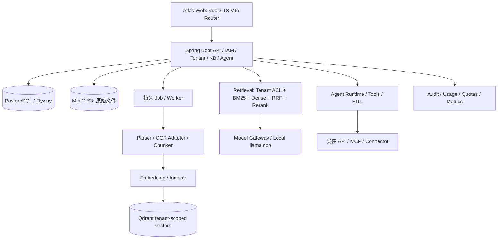

# Atlas AI Platform — 正式產品升級 PRD 與技術實作規格

**版本**：v1.0｜**日期**：2026-11-20｜**需求性質**：既有專案全面產品化重構｜**專案**：[jackteng-dev/atlas-rag](https://github.com/jackteng-dev/atlas-rag)

> **本次決策**：允許 Claude 在**本機隔離環境**對 Atlas 進行一次完整、大幅度重構，盡可能先達成最終平台的功能廣度與可運作的端到端垂直流程，之後再集中進行 UX、效能與品質優化。**不可因為開發中的 PR 被合併，就讓現有正式伺服器提前自動部署新版。** 正式部署另由伺服器端 Claude／Cloud 工作階段依切換文件一次完成。

## 1. 產品願景與定位

Atlas 從「本機 RAG 文件助理」升級為**企業級 AI 知識營運與 Agent 平台**（Enterprise KnowledgeOps + Agentic AI Platform），支援 SaaS 多租戶與 Self-hosted 私有部署兩種模式。使用者透過瀏覽器建立組織、邀請成員、管理知識庫、匯入文件、向 AI 提問並核對來源，也可建立受權限約束的 Agent／工作流，將結果透過受控工具送入企業流程。

**產品原則**：資料主權、可引用、可稽核、權限先行、離線優先、模組化、可運維。CosmosIDP 是功能範圍與產品定位的參考，不複製其 UI、商標、文案或專有設計；規格以 Atlas 自有產品體驗為主。

### 1.1 目標客群與情境

| 客群 | 核心需求 | 代表情境 |
|---|---|---|
| 個人／小型團隊 | 上傳文件、建立私有知識庫、問答 | 技術文件、SOP、內部手冊 |
| 中小企業 | 組織與成員管理、不同知識庫、權限隔離 | 人資／工程／品保部門問答 |
| 高隱私企業 | 私有化部署、可選本地模型、資料不外流 | 內部規範、客戶規格、保密資料 |
| 製造業／ERP 場景 | 規格比對、文件審核、受控查詢與工作流 | Datasheet 比對、RFQ、SOP、ERP 唯讀查詢 |

### 1.2 產品版型

- **Atlas Cloud（未來 SaaS）**：每家公司為一個 Tenant。使用者登入後可加入多組織；原始文件、向量、聊天、稽核都按租戶隔離。
- **Atlas Private（Self-hosted）**：同一份程式部署到客戶內網／私有環境，模型可完全本地運行；不需連 Atlas 雲端控制面才能使用基本功能。
- **Atlas Connect**：透過授權的 Connector／API／MCP 存取現有企業資料，不要求所有員工重複上傳文件；連線和外部模型的資料外送策略必須可視、可停用。

## 2. 既有專案現況（GitHub `main`：`26f19351b34f7951217552852ae0a1a68b560893`）

**截至 2026-11-20 靜態審查結果；實際開始修改前 Claude 必須重新 fetch／驗證當下 main，不可把本文當成執行環境現況。**

### 2.1 必須保留的資產

| 已有能力 | 實作／文件來源 | 保留策略 |
|---|---|---|
| Java 21、Spring Boot 3.5、Vue 3、TS、Vite | `backend/pom.xml`、`frontend/` | 沿用並模組化，不為重寫而換語言 |
| BGE-M3、Qdrant、BM25、RRF、BGE reranker | `RagEngine.java`、`RAG_STACK.md` | 保留核心檢索邏輯，換成可測試的介面與持久化索引流程 |
| 本地 Qwen3 4B／8B、llama.cpp | `LlamaRagModels.java`、`README.md` | 原有免費本地模型作為正式預設，不自動接付費 API |
| 版本化 Chunk、來源行號、失效引用拒絕 | `DocumentStore.java`、`ApiController.java` | 保留語意和契約，擴充多文件格式／組織命名空間 |
| 角色、部門、文件到期檢查 | `DocumentAccess.java` | 延伸成租戶 + 工作區 + 文件 ACL；拒絕越權洩漏 |
| 背景提問、引用發布前再檢查 | `QuestionJobs.java` | 升級成可持久化的工作系統，保留安全檢查 |
| JUnit、Playwright、Ragas、現有凍結評測 | `backend/src/test`、`frontend/e2e`、`eval/` | 原始 benchmark 不改寫；增加獨立新測試集 |
| CI、私有 GHCR、既有自架 CD | `.github/workflows`、`AGENTS.md` | 保留既有正式環境契約，新的完整平台在本機隔離開發 |

### 2.2 目前已確認缺口

| 缺口 | 現狀 | 產品目標 |
|---|---|---|
| 儲存 | 單一 JSON 原文與全量快照 | PostgreSQL 關聯資料、MinIO/S3 原檔、Qdrant 向量 |
| 登入與使用者 | 靜態 JSON bcrypt + Basic，需重啟 | 動態使用者、組織邀請、角色、Session／OIDC 選項 |
| 組織隔離 | 部門／角色非 Tenant | Tenant、Workspace、KB、Document 多層隔離 |
| 文件格式 | 僅 Markdown；Web 檔案 ≤600KB | MD/TXT/PDF/DOCX/XLSX；OCR 可插拔；大型檔案非同步 |
| 問答並行 | 一次一份推論，`503 MODEL_BUSY` | 持久任務、佇列、每組織配額、限流與公平排程 |
| 使用者介面 | 主要為問答／文件庫 | 完整資訊架構與多頁式後台 |
| 對話歷史 | 未見持久化記錄 | Conversation、Message、Citation 關聯與保留政策 |
| Agent | 未見正式功能 | Agent 定義、工具白名單、工作流、HITL |
| Provider 與管理 | 4B/8B 選擇 | 本地模型路由、部署／健康／使用量／費用面板 |
| 整合 | 無正式 Connector/MCP 管理 | 可控的唯讀資料連接與 Agent 工具執行 |
| 商用治理 | 缺統一租戶維度 | 審計、配額、成本、監控、備份還原、維運工具 |

**重要既有缺陷**：未設定驗證的 `PUBLIC_DEMO` 模式允許匿名修改符合條件的公開文件，不得直接用於正式對外站。`QuestionJobs` 單一 Executor/記憶體 Job 不適合多使用者持久任務。模型 CPU 吞吐無法因為有佇列而被神奇放大。

## 3. 本次大改範圍與完成策略

**允許一次大改**：不是先寫計畫就停，而是在同一條**長期大型開發分支**完成系統功能的大部分，依模組提交 checkpoint，並在本機反覆整合與驗收。Claude 可刪除或重整舊版展示 UI、套件與 API，但必須先設計清楚資料搬遷、舊引用品質與回滾策略，不得不可逆地破壞來源。

**先功能完整，再修細節** 不等於先做無安全性的 Demo：租戶邊界、登入、檔案安全、資料儲存及可靠部署的基本安全線在第一天就必須成立。其他高級功能可以先做到「可用的最小完整垂直流程」，後續再優化。

### 3.1 必交付模組與優先度

| ID | 功能模組 | 首輪完成要求 | 驗收重點 |
|---|---|---|---|
| CORE-01 | Tenant / Organization / Workspace | 建立、切換、邀請成員、角色 | A 組織讀不到 B 組織任何資料 |
| CORE-02 | IAM / RBAC / ACL | 動態帳號、密碼安全、成員權限、文件政策 | 前後端皆拒絕越權；匿名零寫入 |
| CORE-03 | SQL / Object / Vector Storage | PostgreSQL + Flyway、S3/MinIO、Qdrant | migration 可重跑，資料保留、一致性 |
| DOC-01 | 文件上傳與智慧解析 | MD/TXT/PDF/DOCX/XLSX、狀態、失敗重試 | 可上傳、處理、查詢、引用來源 |
| DOC-02 | Knowledge Base / Versions | 知識庫 CRUD、文件版本、Chunk、重新索引、刪除 | 舊引用失效且舊向量不洩漏 |
| RAG-01 | 問答引擎 | BM25 + 向量 + RRF + Rerank + LLM | 保留拒答、來源、授權過濾 |
| RAG-02 | Chat 與歷史 | Conversation/Message、分 KB 問答、來源檢視 | 切換身分與租戶不可取回他人回應 |
| RUN-01 | 非同步 Worker / Job | 上傳索引、問答、Agent 任務、重試／取消 | 重新啟動後任務狀態可恢復／合理標記 |
| AI-01 | Model Gateway | 本地 4B/8B、Provider 抽象、健康資訊 | 不自動傳資料到付費／外部模型 |
| AI-02 | Agent / Workflow | Agent CRUD、範本、序列節點、執行紀錄 | 至少一條真實可執行的端到端工作流 |
| AI-03 | HITL / Tool Security | 審核佇列、白名單工具、批准後寫入 | 未審核不可對外寫入；可稽核 |
| AI-04 | Connector / MCP | 至少本地文件與受控 HTTP／SQL 唯讀 Adapter | SSRF 防護、憑證保護、限制來源 |
| OPS-01 | Usage / Quota / Audit | Token、模型延遲、配額、稽核檢視 | 可依公司／成員／Agent 查詢，超額限流 |
| OPS-02 | Admin / Monitoring | 後台、檢索品質報告、健康檢查與 Job 檢視 | 管理員可排錯且無敏感內容曝光 |
| UX-01 | 正式前端 | 登入、組織、Chat、知識庫、文件、Agent、設定 | Desktop + Mobile 可操作；無死按鈕 |
| DEL-01 | 本機完整部署 | Docker Compose 開發堆疊、種子示範、文件 | 新機一鍵／少量命令可重現 |
| DEL-02 | 伺服器切換交接包 | 路徑、差異、遷移、備份、回滾、健康驗收 | 伺服器端 Claude 能先預檢後一次切換 |

### 3.2 後續精修項目（首輪可延後，但須明示）

高階 OCR 版面理解／表格校準、多節點拖拉視覺編輯器、完整多 Agent A2A、GraphRAG、完整 ERP/MES 商用連接器、SSO 企業識別供應商全矩陣、SaaS 實際金流、自動帳單、多國語系、多區域容災、GPU 大型叢集擴展。這些可先建立介面、受控範本與能力旗標，但**不可把空殼或假資料標示為已實作可用**。

## 4. 技術架構（目標）

**架構指導**：

- 後端主體沿用 **Java 21 + Spring Boot 3.5**，採模組化單體與清楚邊界（`identity`, `tenant`, `knowledge`, `ingestion`, `rag`, `chat`, `agent`, `integration`, `operations`）。不要一開始拆十個微服務。
- 前端 **Vue 3 + TypeScript + Vite + Vue Router + Pinia**；保留可驗證的既有互動，提升為獨立頁面與可重用元件。
- **PostgreSQL + Flyway** 作正式記錄和權限政策單一真實來源；避免 JPA 直接把大二進位原檔存入 DB。檔案交給 MinIO/S3；Qdrant 只做衍生索引。若使用 PostgreSQL 實作 BM25／全文搜尋，應做實測與中文斷詞設計，勿宣稱與既有 BM25 等價。
- **持久性工作佇列**：首選 PostgreSQL Job Table + `FOR UPDATE SKIP LOCKED`、Lease、retry/backoff、冪等與 cancel；需求成長後可換 Redis Streams／獨立 broker。佇列可排隊，模型併行仍要受 CPU/GPU 容量限制。
- **模型**：保留 Qwen3 4B／8B + llama.cpp；以 Provider interface 封裝未來可選的其他**本地**模型路由。雲端模型 Provider 預設關閉，除非有明確租戶與管理員授權及資料政策，且不得私自使用付費 API。
- **OCR**：解析工具可以選 Apache Tika/PDFBox/POI + 可選 OCR Worker。OCR 引擎不可用時清楚標示 `NEEDS_OCR`，不得偽造內容。
- **部署**：Docker Compose Dev（Postgres、MinIO、Qdrant、API、Worker、Web、模型可選）；Docker Compose Private Production Spec 與 SaaS Production Spec 分開，正式環境不得以本機開發 Compose 直接替換。

## 5. 主要資料模型（起始建議，可依程式碼調整）

| Entity / Table | 主要欄位 | 重要不變量 |
|---|---|---|
| `users` | id, email, password_hash, status | 電子郵件唯一、密碼雜湊、停用生效 |
| `organizations` | id, name, slug, status, plan | Tenant ID 不可由客戶端自行決定資料存取 |
| `memberships` | org_id, user_id, role, status | 同一人可屬多個 org；角色由伺服器授權 |
| `workspaces` | id, org_id, name | 查詢全部帶 org_id；不可跨租戶引用 |
| `knowledge_bases` | id, org_id, workspace_id, name, visibility | 租戶與工作區雙重檢查 |
| `documents` | id, org_id, kb_id, owner_id, current_version, status | 檔案讀取與檢索均檢查 ACL |
| `document_versions` | id, document_id, version, sha256, object_key, parser_version | 版本唯一、原始檔可追溯 |
| `document_chunks` | id, org_id, doc_version_id, line/page, hash, content | 引用綁定 doc version + chunk id |
| `ingestion_jobs` / `jobs` | id, org_id, type, state, attempts, lease_until, idempotency_key | 可重試、可恢復、操作冪等 |
| `conversations` / `messages` | id, org_id, kb_id, user_id, role, content | 權限與刪除政策一致 |
| `message_citations` | message_id, document_version_id, chunk_id, locator | 精確來源版本且可核驗 |
| `agents` / `agent_versions` | id, org_id, definition, approved_tools, enabled | 無權工具不得執行 |
| `workflow_runs` / `tool_calls` / `approvals` | id, org_id, actor, status, payload_ref | 寫入性工具一定要能覆核追溯 |
| `connectors` | id, org_id, type, config_ref, policy | 密鑰存密鑰庫／安全配置，不明文落 DB |
| `usage_events` / `quotas` | org_id, user_id, model, tokens, status, limits | 計量及拒絕超額可驗證 |
| `audit_events` | id, org_id, actor, action, resource, request_id, result | 事件可信、可保留與查詢 |

**Database 約束**：所有需租戶隔離的表必須能追到 `org_id`；Foreign Key、Unique、索引與 SQL policy 要能防止「A 租戶 parent + B 租戶 child」的交叉引用。對難以用 FK 表達的部分加 repository/service 層及安全測試；可評估 PostgreSQL RLS 作防禦縱深，不能只靠前端的 org selector。

## 6. 功能行為細則

### 6.1 身分、組織與資料安全

- 預設**拒絕匿名寫入**；正式站不啟用 `PUBLIC_DEMO`。第一次啟動可用安全的環境變數／一次性 bootstrap 建立管理員（不得硬編密碼）。
- 第一期可用 Spring Security Server-side Session + `HttpOnly`、`Secure`、`SameSite` Cookie 與 CSRF 防護；若採 Access Token，必須提供完整 refresh／撤銷與 XSS 風險模型。OIDC/企業 SSO 可做為後續 Adapter。
- 權限模型至少涵蓋 System Admin、Organization Owner/Admin、Workspace Manager、Editor、Viewer；文件的 owner、授權角色、有效期、Visibility／ACL 可細化。
- Tenant scope 適用文件清單、原始檔下載、向量查詢／回傳、BM25、Chunk、LLM 上下文、對話歷史、工作狀態、Agent Tool、快取、日誌及備份。
- 稽核不儲存原始密碼、token、未遮罩的機密檔案內容；敏感內容顯示時依 RBAC／Need-to-Know 控制。使用者刪除與保留期限要有實際清理／排程。

### 6.2 文件資料處理 Pipeline

`RECEIVED → VALIDATING → STORED → PARSING → CHUNKING → EMBEDDING → INDEXING → READY`；失敗轉 `FAILED`，需 OCR 轉 `NEEDS_OCR`，手動重試後可回到處理中。可選 `CANCELLED` / `DELETING`。

- MIME／副檔名／檔頭多重驗證、檔案大小限制、ZIP bomb／路徑穿越防護、可配置隔離與惡意檔掃描。
- PDF 提取文字與頁碼、Word 標題層級、Excel sheet/row/column 與表格；每個 Chunk 帶原始來源 `page/section/row`、哈希與 parser version。
- 同檔案重複匯入與改版採內容 Hash／Idempotency；Indexing 必須先建立新版本再原子切換，避免部分索引被當成 `READY`。
- 文件刪除／權限變更立即阻止未授權讀取；舊向量清理可異步但不能被檢索回傳。索引工作因錯誤失敗必須能重試並回復一致狀態。

### 6.3 RAG 與對話

- 保留 existing BM25 + BGE-M3 + RRF + Reranker + Qwen3，加入可配置檢索 KB 範圍、版本與 Tenant ACL 過濾，後端再二次驗權。
- 引用要有文件標題、版本、頁／行位置、來源片段、可核對的連結；文件改版時舊引用需指出版本失效／不可存取，不可靜默回到新版本內容。
- 支援單輪／多輪 Conversation；歷史對話在失去 KB／Document 權限後也不能繼續洩漏原引用（存取、遮罩或刪除策略要一致）。
- 證據不足可拒答；Prompt injection 視為資料、不能變成工具指令。對小模型保留已知不足與品質報告，不做無根據準確率宣稱。

### 6.4 Agent、Workflow、MCP

- 首輪至少三種實際可操作範例：`知識問答 Agent`、`文件抽取/比對 Agent`、`唯讀工具 Agent`。可建立 Agent 並綁定知識庫、模型、提示詞版本、工具白名單及執行配額。
- 工作流至少支援 `Trigger → Retrieve/Parse → LLM/Rule → Approval（可選） → Read-only Tool/Output`；執行可追蹤、取消、重試、檢視每一步結果。
- **預設禁止未授權的寫入／任意指令碼／Shell 執行**。所有有副作用的操作需明確授權、HITL 覆核、冪等與稽核；MCP Server 是受控連接器，不可接受任意使用者提交的外網 endpoint 或工具函數。
- 內建工具優先唯讀：SQL SELECT allowlist、受限 HTTP GET 或查詢內部演示 API。防 SSRF、DNS rebinding、權限繞過及 credentials 洩漏。

### 6.5 管理、觀察與評測

- 租戶／使用者／KB／Agent 用量，至少記錄 Token、模型、耗時、Job 狀態、請求數與資源歸屬；不推定真實貨幣成本，除非已設定單價。
- 支援限流、月用量軟／硬限額、失敗原因、API/模型健康、歷史請求查詢；維持每次 `request_id` 與跨步驟 `trace_id`。
- RAG 評測沿用舊資料保護，新增對多租戶／中英混合／PDF／OCR／跨文件／錯誤前提的獨立題集；UI 顯示實測條件、樣本數與限制。

## 7. 前端導覽與 UX

**主要導航**：Overview、AI Chat、Knowledge Bases、Documents、Agents、Workflows、Approvals、Connectors、Evaluation、Usage、Audit、Organization Settings、System Admin（依權限出現）。

**主要頁面**：登入／邀請接受／組織選擇；Chat 多對話與側邊引用來源；文件中心（上傳進度、失敗原因、重新索引）；知識庫權限；Agent 詳細設定與 Run Timeline；管理者後台（用量、成員、角色、Provider、稽核）。

**設計原則**：乾淨現代的 B2B SaaS 風格；全新 Atlas 品牌介面，不複製 CosmosIDP。Desktop-first 但手機可基本查詢與管理；表單、錯誤、等待、空狀態、權限拒絕和取消操作均有實際互動；不允許看似可點卻未實作的假按鈕。高階功能若未完成，明示 `Coming Later` 並停用。

## 8. 完整驗收與非功能需求

| 類別 | 最低驗收 |
|---|---|
| 跨租戶 | A/B 兩個 org，包含登入、API 直接指定 ID、向量、原檔、引用、Job、對話、Agent、審計的負向測試；預期 403/404，不露資料 |
| 文件 | MD/TXT/PDF/DOCX/XLSX 真正能解析和查詢；掃描 PDF 若 OCR 不可用要回報 `NEEDS_OCR` |
| 版本 | 更新、刪除、到期、改 ACL 後舊引用不再可見；索引失敗可重試，不漏舊文件 |
| 安全 | 無未授權寫入、無硬編帳密、CSRF/session 合理、輸入過濾、下載授權與第三方 URL 限制 |
| 執行 | 同時送出多份任務時排隊／配額生效；服務重新啟動後能恢復或標記可重試，不憑空宣稱 GPU 並行 |
| Agent | 至少一個從文件擷取→規則→人工審核→受控結果輸出的真實完整案例 |
| 工程 | Maven verify、前端 typecheck/build、隔離 DB integration、Playwright 核心情境、migration/backup/restore 測試 |
| 維運 | 一份本機 Compose 啟動指南；必要 env example、健康／指標／日誌、回滾方法、資料保護方案 |
| 品質 | 既有 eval 原始紀錄保留；新 eval 不覆寫舊 frozen holdout；結果實測且標註限制 |

**效能目標**：定義測試情境後再訂 SLA；初版建議測量 `cold/warm RAG latency`, `P50/P95`, ingestion throughput, 5–20 虛擬使用者的排隊行為及 CPU/RAM 使用量。沒有執行前不得給產品宣傳數字。

## 9. 一次大改的開發執行方式（本機）

1. **只操作 `atlas-rag`**，先盤點現有分支、git status、上游 main、AGENTS/HANDOFF、所有 CD 受保護路徑與資料契約；保存現況。
2. **開 `feature/atlas-platform-v1` 長期分支**，本機重構並使用新空資料庫／儲存桶／向量 collection，嚴禁連現有正式資料或覆蓋模型、密鑰、正式 Index。
3. 在同一長期分支依 **IAM/租戶→儲存→文件→RAG→UI→Agent→Ops→E2E** 的依賴順序連續實作，不因完成早期模組就要求使用者逐次發提示。每個 checkpoint 跑測試、commit、更新 handoff；在失去工作階段前保存進度。
4. 功能做到接近最終目標後再集中做 UI 精修、效能、可維護性與更多 Connector；不得拿 UI 截圖假裝後端已實作。
5. 允許大型不相容改動，但**必須**產出 `MIGRATION_PLAN`、`DATA_COMPATIBILITY_MATRIX`、`ROLLBACK_PLAN`，並提供原 JSON Store → PostgreSQL 的明確離線匯入／校驗程序；正式資料只允許在最後切換當日按 runbook 操作。
6. 開發中可建立 **Draft PR** 做 CI/Review，但**不得在尚未完成伺服器預檢與切換計畫前合併至 main**。原因：目前 main 已與 GHCR/CD 自動部署相連，正常 merge 可能直接觸發正式部署。如果堅持提前 merge，必須由伺服器端管理者先確認自動發布／部署已安全暫停並提供證據；沒有證據就留在 feature branch。
7. 最後由伺服器端 Claude／Cloud 只讀盤點主機與現有 CD，按照簽核的 handoff 執行備份、隔離演練、新版 side-by-side、驗收、切換、回滾準備；使用者授權後才一次正式部署。

## 10. 正式切換條件與交接成果

Claude 在本機完成時必須交付：

- `docs/platform/IMPLEMENTATION_REPORT.md`：功能矩陣（完成／部分／未完成）、實測結果、當前 branch/SHA、已知限制。
- `docs/platform/ARCHITECTURE.md`、`API.md`、`DB_SCHEMA.md`、`SECURITY_MODEL.md`、`DATA_COMPATIBILITY_MATRIX.md`。
- `docs/platform/MIGRATION_PLAN.md`、`ROLLBACK_PLAN.md`、`LOCAL_DEPLOYMENT.md`、`EVALUATION_REPORT.md`。
- **`docs/platform/SERVER_CLOUD_HANDOFF.md`**：給伺服器端 Claude 的逐步切換文件，依另外的 handoff 範本補完整值，不含密碼；區分自動部署與有權限的人員批准。
- `.env.example`（只放欄位與假值）、可重現的開發部署工具、整合／E2E 測試。

**不得交付**：任意正式資料 dump、token、帳號密碼、未驗證的「已上線」宣稱、未經授權的 `main` 合併或 CD 修改。

## 11. 參考來源與優先順序

- 現況基準：[README](https://github.com/jackteng-dev/atlas-rag/blob/main/README.md)、[AGENTS](https://github.com/jackteng-dev/atlas-rag/blob/main/AGENTS.md)、[RAG_STACK](https://github.com/jackteng-dev/atlas-rag/blob/main/docs/RAG_STACK.md)、[ARCHITECTURE](https://github.com/jackteng-dev/atlas-rag/blob/main/docs/ARCHITECTURE.md)、[LOCAL_DEPLOYMENT](https://github.com/jackteng-dev/atlas-rag/blob/main/docs/LOCAL_DEPLOYMENT.md)。
- 提案參考：使用者提供《精誠資訊 AI 系統提案說明簡報》（2026/09/02），特別是 32–35、39–42、47–51、53–69、71–75 頁。其功能是參考標準，並非已證實 Atlas 具備的功能。
- **如果最新實際原始碼／AGENTS 與本文件現況敘述衝突**：以即時程式碼和正式環境保護條款為準；如果既有自動 CD 與「本機完成後一次正式部署」衝突，以後者作為本次交付目標並先安全隔離。
